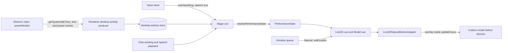

# Natural motion v2 and the performance state

Date: 2026-10-17
Status: accepted

## Decision and scope

The Live2D Natural motion driver becomes a layered, per-frame overlay that reacts to what the character and the user are doing.
The stage resolves a performance state from chat, voice, and desktop signals and passes it to the Live2D scene.
Natural reads that state, the user's Energy setting, and chat emotions, and writes only the channels it owns.

This ADR records the contracts that cross package and process boundaries:

- the performance-state resolver in `@proj-airi/stage-shared/performance-state`;
- the desktop-activity snapshot and its store in `@proj-airi/stage-shared/stores/desktop-activity`;
- the Electron eventa invoke `getSystemIdleTime` and the speech-bus event `speechInputUserSpeakingChangedEvent`;
- the SDK save/load bracket that makes Natural a per-frame overlay, and the ownership rules built on it;
- emotion routing by motion driver;
- Linux and Wayland degradation;
- the private-data policy for reference recordings.

## Architecture

## Performance-state resolver contract

`resolvePerformanceState(inputs, previous)` is a pure function.
It reads time only from `inputs.nowMs` (epoch milliseconds) and keeps all hysteresis in the returned `ResolverMemory`. The caller passes that memory back on the next call and starts from `initialResolverMemory`.
The resolver clamps time so that it never runs backwards, so a clock that steps back cannot reopen dwell windows.

The inputs are:

| Input | Meaning |
| --- | --- |
| `speaking` | The character's own speech is playing. |
| `userSpeaking` | True while voice input is capturing. |
| `generating` | The chat is generating a reply. |
| `cursorMovedAtMs` | When the pointer last moved over the stage, or `null` when the host cannot tell. |
| `desktop` | The latest `DesktopActivitySnapshot`, or `null` when the host writes none. |
| `visible` | Whether the stage document is visible. |
| `override` | A developer `PerformanceOverride`, or `null`. |

The mode priority, highest first, is `talking`, `listening`, `thinking`, `watching`, and `idle`.
`listening` holds for 500 ms after user speech ends, measured from the first call that reports `userSpeaking` as false. The caller must therefore resolve at once when that input changes.
The first mode switch applies at once. After that, a new mode replaces the current one only after the current mode has held for 300 ms.
An override replaces the mode at once, without dwell.

`watching` requires a visible stage, a user who is not away, and recent activity: a pointer move within 3 s, desktop input within 10 s, a screen change above 0.15, or system audio above 0.1.
In `watching`, `attention` is `cursor` when the pointer moved recently and `screen` otherwise. In every other mode, it is `camera`.
`away` is an overlay on the mode, not a mode. It is true when the desktop is locked, suspended, or idle for more than 300 s.

`reactSeq` increments once per reaction, and `reactKind` names the reaction.
A `wake` happens when a new unlock or resume time appears after the first snapshot. The first snapshot is only a baseline, because its times can be hours old.
A `screen-change` happens when the screen change crosses above 0.35, at most once per 10 s. A wake in the same frame wins.
Consumers start a reaction when `reactSeq` differs from the value they last saw. Natural ignores the first value it sees, because a reaction that happened before the controller existed is stale.

Every threshold is a named starting value with a tuning comment in the resolver source.

`Stage.vue` is the only caller. It resolves every 250 ms and whenever an input changes, and it replaces the `performance` prop only when a field changes.

## Desktop-activity snapshot

`DesktopActivitySnapshot` carries `idleSeconds`, `locked`, `suspendedAtMs`, `resumedAtMs`, `unlockedAtMs`, `systemAudioLevel`, `screenChange`, and `sampledAtMs`.
Timestamps share the epoch clock of `nowMs`.
A `null` field means that the host cannot measure that signal. The resolver never treats an unknown signal as activity, and it treats NaN, infinities, and negative idle times as unknown.

`useDesktopActivityStore` holds the latest snapshot. It is runtime state: it is neither persisted nor replicated, because each renderer reads only its own host's samples.
In Electron, the renderer store `useDesktopActivityProducerStore` writes the snapshot:

- It polls `getSystemIdleTime` once per second while the stage window is visible and not minimized, and stops polling otherwise.
- It updates `locked`, `unlockedAtMs`, `suspendedAtMs`, and `resumedAtMs` from the existing power monitor events.
- It reads `systemAudioLevel` only while system-audio lipsync already runs, and `screenChange` only while screen ambient light already runs. Otherwise both fields are `null`. The producer never starts a capture.
- It derives `screenChange` from the ambient-light exposure as the gap between a fast and a slow follower.
- It resets the store when it stops, because a stale sample would read as live data.

The web host writes no snapshot, so `desktop` is `null`.

## Electron and speech-bus contracts

`packages/electron-eventa` defines the invoke `electron.powerMonitor.getSystemIdleTime` as `defineInvokeEventa<number | null>('eventa:invoke:electron:power-monitor:get-system-idle-time')`.
It returns whole seconds since the last keyboard or mouse input anywhere on the desktop, or `null` when the host cannot measure idle time.
The main service `createDesktopActivityService` answers it with `powerMonitor.getSystemIdleTime()`, or with `null` on a Linux Wayland session (see Linux and Wayland degradation). The handler is window-scoped and is removed when the window closes or the app quits.
The main process never polls on its own; the renderer polls only while the stage is visible.

`packages/stage-ui/src/services/speech/bus.ts` defines `speechInputUserSpeakingChangedEvent` as `defineEventa<{ speaking: boolean }>('eventa:audio:speech:input:user-speaking-changed')`.
The voice store emits it when its `userSpeaking` value changes. That value is true while voice input is capturing. A stage in another window uses the event to resolve `listening`.
Only changes are sent. A stage that mounts later starts from `false` until the next change.
The stage combines the local voice store value with the last value received on the bus.

## Natural as a per-frame overlay

`Live2DNaturalMotionAdapter` replaces the model's SDK `updateFocus` method and composes every Natural write inside it.
The SDK runs focus after motions and AIRI's final plugins and before physics.
The SDK brackets the model update with `saveParameters()` and `loadParameters()`, so each Natural write is a stateless overlay on that frame's post-motion values. Natural values never feed back into the next frame's base values.
The replacement is a workaround marked with `NOTICE`. It can be removed when the SDK exposes a public pre-physics composition hook.
Disposal restores the original method before the model is destroyed.

The controller runs on a fixed 120 Hz grid in active seconds. The active clock freezes while the stage is paused or hidden, and Natural resumes from the frozen state without a jump.

## Ownership rules

`readLive2DRigProfile` discovers which Natural channels a model has and which parameters its physics outputs. It also detects body axes that physics derives from the head.
The adapter applies these rules:

- Natural writes head XYZ, body XYZ, and eye XY posture. It skips a body axis that physics derives from the head.
- Natural composes face micro-offsets on brows, eye smile, and mouth form, and composes the eyelids.
- Natural composes cheek offsets from pet and held-emotion hints; otherwise it leaves the channel at its base value.
- Natural blink replaces the SDK blink plugin while Natural is selected, and it blinks only while the user's auto-blink setting is on.
- Natural writes breath unless manual breath control is active.
- Natural never writes a parameter that physics outputs.
- Natural does not write the mouth-opening channel (`ParamMouthOpenY`) while the character speaks or within 0.7 s after speech ends, so lipsync owns mouth opening. Other face offsets, including mouth form, still compose.
- Posture fades out while manual or spring motion control is active.
- While an exclusive owner holds the model, posture fades out, the controller suspends, and face, blink, and breath composition stops.
- On a channel that a playing explicit clip animates, posture keeps a 10% residual, and face channels are skipped.
- Eyelids that an expression closes (0.15 or lower) stay closed, and micro-narrowing never lowers open eyelids below 0.2 outside a blink.

## Emotion routing by driver

The stage emotion queue routes each emotion by renderer and Live2D motion driver:

| Renderer and driver | Route |
| --- | --- |
| Live2D with Natural | `Live2D.vue` queues Natural emotion episodes through the performance conductor. This replaces the earlier `setEmotion(name, intensity)` interface. See [2026-10-18-expression-performance](2026-10-18-expression-performance.md) and [2026-10-19-natural-emotion-revamp](2026-10-19-natural-emotion-revamp.md). |
| Live2D with Universal or MAGIC | The emotion's motion group plays through the Live2D parameter store. |
| VRM | The VRM viewer sets the matching expression. |
| Spine | The Spine scene's `setEmotion` handles it. |
| Tachie | The tachie scene's `setEmotion` handles it. |
| MMD | The MMD scene's `setEmotion` handles it. |

A Natural impulse is a short head gesture plus decaying face hints, and some emotions add a glance.
Impulses add to every other layer, so they never reset the pose. Neutral does nothing. The earlier local two-second emotion dedupe described here was superseded by conductor-managed episodes; see [2026-10-18-expression-performance](2026-10-18-expression-performance.md) and [2026-10-19-natural-emotion-revamp](2026-10-19-natural-emotion-revamp.md).
The adapter drops emotions queued while Natural is inactive, because they are stale by the time it resumes.
Only a desktop reaction or a poke raises posture amplitude and shift rate for 2 s; an emotion impulse no longer does (see [2026-10-18-expression-performance](2026-10-18-expression-performance.md)).

## Linux and Wayland degradation

Hosts without desktop data degrade to `idle` instead of guessing.
On the web host, `desktop` is `null`.
When a signal is unknown, the producer reports `null`, and a `null` field never selects `watching`. The resolver test covers an all-null snapshot.
On the Wayland Ozone backend, Electron cannot read the cursor position reliably. If the stage never receives pointer moves, `cursorMovedAtMs` stays `null` and does not count as activity.

On a Linux Wayland session, Electron can report a constant idle time of 0 because it cannot measure desktop idle time there. The resolver would read that 0 as recent input and select `watching` while the stage is visible.
So the Electron main process answers idle time as `null` when `process.platform` is `linux` and `XDG_SESSION_TYPE` is `wayland`, whether Electron runs on the Wayland Ozone backend or under XWayland. The snapshot then carries `idleSeconds: null`, and the resolver falls back to `idle`.
On Windows, macOS, and Linux X11, the producer passes the measured value through, and 0 means recent input.
The constant 0 on Wayland has not been observed on a real Wayland session in this work.

## Energy

The user's Energy setting is a number from 0 to 1, stored as `settings/live2d/natural-energy`, with a default of 0.5.
An unparsable stored value falls back to the default, and an out-of-range value is clamped when read.
Energy `E` scales posture amplitude by `0.7 + 0.6E` and shift rate by `0.6 + 0.8E`. At 0.5, it leaves every layer unscaled.
A developer `PerformanceOverride` can force an energy value. It is held in the replicated, non-persisted `natural-performance-override` store in `@proj-airi/stage-ui`.

## Private-data policy for references

The liveliness reference statistics come from private `.riggold` recordings of a human performer.
Recordings, exported traces, captured traces, model files, and model screenshots are never committed.
Evidence and traces stay under `.omo/evidence/`, which the root `.gitignore` ignores.
Only the derived statistics in `packages/stage-ui-live2d/src/composables/live2d/natural-motion/reference-stats.ts` are committed. Their provenance comment names the recorder and the session ids, not file paths.
Documentation refers to recordings only by placeholder paths.

## Non-goals

- No per-layer tuning controls in Settings. Only the Energy slider and the cursor attention toggle are user-facing.
  Superseded in part by 2026-10-19-natural-emotion-revamp: Settings also show per-model emotion strength sliders and the held-emotions switch.
- No new main-process polling. The renderer polls idle time only while the stage is visible.
- No change to Universal or MAGIC motion behavior.

## Cursor recency

Natural owns cursor recency and attention decay. `Live2D.vue` retains the last host cursor position without applying its 1000 ms expiry while Natural is selected; the controller fades attention when the host reports no cursor. Other motion drivers keep the scene's 1000 ms expiry.

Natural does not null the cursor when performance attention becomes `screen` or when an ACT cue selects `aside`. These states grant dismiss permission, so Natural can look away while retaining the cursor and its own attention history. Disabling cursor attention instead sends a null cursor with dismissal. A dismiss edge emits a dismissal only for an oriented notice or full episode. If the episode has already released, the later screen transition is silent and does not force another gaze change. Natural attention details and the head-anchored cursor contract are recorded in [the cursor attention ADR](2026-10-24-live2d-cursor-attention.md).
