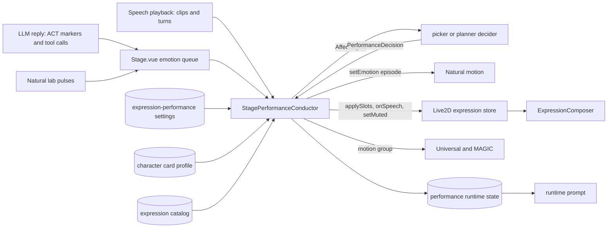

# Expression performance

Date: 2026-10-18
Status: accepted

## Decision and scope

Chat emotions and LLM expression requests reach a Live2D character through one replayable decision seam.
A pure decider in `@proj-airi/stage-shared/expression-performance` turns affect signals into reaction episodes and expression slot commands.
The stage performance conductor in `@proj-airi/stage-ui` feeds the decider and dispatches its decisions. The Live2D performer in `@proj-airi/stage-ui-live2d` executes them.
Natural motion reacts to each episode by intensity band and keeps a decaying mood.
The expression runtime composes every `.exp3.json` of a model per expression, and a curated catalog decides which expressions may fire automatically or reach the LLM.

This ADR records the contracts that cross package and window boundaries:

- the decision seam, its signals, and its invariants;
- intensity words, bands, habituation, and escalation;
- the Natural band table, the mood dynamics, and the emotion coefficient table;
- per-expression composition and the frame-base ownership rule;
- expression discovery, the catalog, and its storage keys;
- slot lease rules;
- speech timing events, special-marker delivery, the scheduler, and the planner;
- LLM permissions, the expression tools, and the prompt-key rule;
- affect traces, replay, and character profiles;
- the settings document;
- the 48 kHz shared audio context.

## Architecture



## Decision seam

A `Decider<S>` has three functions:

- `initial(seed)` returns the starting state.
- `decide(signal, ctx, state)` returns a `PerformanceDecision` and the next state. The decision holds `episodes` for Natural and `slots` for the expression performer.
- `nextDeadline(state)` returns the earliest monotonic second at which the decider needs a `deadline` signal, or `null`.

The `DeciderContext` holds the catalog and the effective settings.
`createDecider(kind)` returns the picker for `'picker'` and the planner for `'planner'`.

These invariants hold for every decider:

- Decider state is a plain JSON object. Each PRNG state is a uint32, so a state can be checkpointed with `structuredClone` or JSON.
- Deciders never read a clock, `Math.random`, Pinia, or Live2D parameter ids. Every time comes from the signal, in seconds on a monotonic clock.
- The same seed, context, and signals produce the same decisions.

An `AffectSignal` is one of these kinds:

| Kind | Producer | Meaning |
| --- | --- | --- |
| `emotion` | ACT marker, lab pulse | An emotion with a nominal intensity in [0, 1]. |
| `expression` | ACT `expression` field, `set_expression` tool | An LLM-named catalog entry, already validated by the conductor. |
| `clear` | `clear_expression` tool | Releases the named slot, or the face, effect, and prop slots when no slot is named. |
| `speech` | Speech playback | `clip-start`, `clip-end`, `clip-stopped`, or `turn-end` of one turn. |
| `muted` | Speech mute switch | The current muted flag. |
| `timing` | The conductor | A `TimingEvent`: `sentence_start`, `pause`, `utterance_end`, or `emphasis`. |
| `deadline` | The conductor | A deadline that `nextDeadline` requested. |

Signals carry the turn id of their speech turn when one exists. Lab pulses have no turn id.
A slot command copies the turn id of the signal that produced it, so speech-bound leases stay inside their turn.

`clear` and `neutral` differ:

- A `neutral` emotion releases the face and effect slots and resets the reaction history, so the next emotion starts a fresh episode with no habituation.
- A `clear` releases the named slot, or the face, effect, and prop slots. It keeps the reaction history and the current episode's tickets, so a later escalation of the same episode can fill a cleared slot again.

## Intensity, bands, habituation, and escalation

The ACT payload parser in `@proj-airi/pipelines-audio` maps the intensity words `slight`, `clear`, and `strong` (trimmed, case-insensitive) to 0.25, 0.6, and 0.9.
Finite numbers and numeric strings clamp to [0, 1].
A missing, empty, or invalid intensity, and a bare emotion string, mean 0.6.
Before this change a missing intensity meant 1. The new default applies to every renderer, so VRM, MMD, Spine, and Tachie emotions without an intensity now receive 0.6.
The parser also reads an optional `expression` label. It trims the label and does not match it; the conductor resolves it.

`bandOf(intensity, settings)` returns no band for 0 and non-finite values, `slight` below `intensity.clearFrom`, `clear` below `intensity.strongFrom`, and `strong` from `intensity.strongFrom` to 1.

`acceptReaction` tracks reactions:

- A `neutral` emotion or a nominal of 0 clears the history and returns no episode.
- A different emotion clears the habituation history of the previous emotion.
- A new episode of an emotion counts the preceding episodes of the same uninterrupted emotion that started within `intensity.habituationWindow` seconds. With that count `n`, the habituation factor is `h = max(habituationFloor, habituationBase ** n)`.
- The band comes from `nominal * h`. The intensity adds a jitter of up to `intensity.jitter`, drawn once per episode, and stays inside that band.
- A repeat of the same emotion less than `intensity.escalationWindow` seconds after the episode started is part of that episode. A weaker or equal nominal returns no episode. A stronger one returns the same episode id with `escalation: true`, reusing `h` and the jitter draw. The window does not restart.
- Episode ids are `<emotion>-<counter>`.

When the `bands` switch is off, both deciders use a nominal of 0.6 for every emotion, and Natural treats every episode as clear.

## Natural reactions by band

Natural receives each episode through `setEmotion(episode)` as a `NaturalEpisode`: a `ReactionEpisode` with an optional `moodGain` (see Character profiles). Natural no longer deduplicates emotions; the reaction tracker owns episode identity.

| Band | Face hints | Head pulse | Glance | Body lean |
| --- | --- | --- | --- | --- |
| slight | yes | no | no | no |
| clear | yes | yes | yes | no |
| strong | yes | yes | yes | yes |

With `heldEmotions` on, this table describes only the episode impulse. The held posture from [2026-10-19-natural-emotion-revamp](2026-10-19-natural-emotion-revamp.md) also biases the head and the body follower at every band, so the body moves at clear too. For an emotion with a gesture, a gesture clip replaces the head pulse and the body lean, and the clip moves the body only at strong. While that gesture is cooling down, the episode gets no clip and no head pulse or body lean.

The band timings come from `naturalBands.slight`, `naturalBands.clear`, and `naturalBands.strong`:

| Field | slight | clear | strong |
| --- | --- | --- | --- |
| `faceOnsetTau` | 0.14 | 0.1 | 0.07 |
| `headTau` | `null` | 0.38 | 0.24 |
| `overshoot` | 0 | 0.08 | 0.16 |
| `faceHold` | 0.6 | 1.2 | 1.8 |
| `faceReleaseTau` | 0.35 | 0.5 | 0.7 |

The head pulse is `P(s, tau) - overshoot * P(s - 3 tau, tau)` with `P(s, tau) = (s/tau)^2 exp(2 (1 - s/tau))`, scaled by `naturalBands.headGain * I^0.7`.
The body lean is `naturalBands.bodyGain * I` along the normalized emotion direction, with a time constant of `1.5 * headTau`. The body follower does not follow emotion head pulses, so a clear episode's impulse never leans the body. With `heldEmotions` on, the held posture still moves the body at clear. A body axis that rig physics derives from the head still follows the head through physics.
The face envelope is `(1 - exp(-s/faceOnsetTau)) * exp(-max(0, s - faceHold)/faceReleaseTau)`.
An escalation adds only the missing head and body amplitude and moves the face hints from their current values to the new targets over 0.08 s.

An episode does not change the posture amplitude or shift rate scales. An earlier version raised them for a strong episode through `naturalBands.energySeconds`, `energyAmplitude`, and `energyRate`; those settings were removed.
Desktop `wake` and `screen-change` reactions and pokes call `energy.react(at)`, a fixed overlay of x1.3 amplitude and x1.5 shift rate for 2 s. Overlapping reactions do not stack; a later one extends the overlay.
Superseded in part by [2026-10-25-natural-idle-reshape-and-emotion-ducking](2026-10-25-natural-idle-reshape-and-emotion-ducking.md): `energy.react` takes no intensity argument, and the strong-band energy overlay in the table above was removed.

## Mood

`NaturalMood` holds `valence` in [-1, 1], `arousal` in [-1, 1], and `tension` in [0, 1].
Each active-time step decays every dimension by `exp(-dt / tau)` with `moodDynamics.valenceTau`, `arousalTau`, and `tensionTau`.
An episode adds `gain(band) * I * c(emotion)`. The gain is the episode's `moodGain` when present, otherwise the performer's `moodDynamics.slightGain`, `clearGain`, or `strongGain`. An escalation adds only the dose difference.

The emotion coefficient table `c` is a fixed semantic table:

| Emotion | Valence | Arousal | Tension |
| --- | --- | --- | --- |
| happy | 0.7 | 0.5 | -0.2 |
| sad | -0.6 | -0.5 | 0.1 |
| angry | -0.5 | 0.6 | 0.8 |
| think | 0 | -0.15 | 0.15 |
| surprised | 0.1 | 0.8 | 0.35 |
| awkward | -0.25 | 0.15 | 0.6 |
| question | 0 | 0.1 | 0.1 |
| curious | 0.2 | 0.3 | 0 |
| neutral | 0 | 0 | 0 |

While the `mood` switch is on and any dimension is non-zero, mood modulates each step once:

- posture amplitude by `clamp(1 + amplitude * arousal, 0.8, 1.2)`;
- posture shift rate by `clamp(1 + shiftRate * arousal, 0.7, 1.3)`;
- camera fixation probability by `+ cameraValence * valence - cameraTension * tension`;
- speech emphasis acceptance by `+ emphasis * arousal`;
- mouth form by `+ mouthForm * valence`.

At exactly zero mood Natural skips modulation and draws no randomness, so idle motion and the idle liveliness gate are unchanged.

## Per-expression composition

`ExpressionComposer` keeps one instance per active expression.
A fade uses `S(u) = (1 - cos(pi * u)) / 2` over the file's `FadeInTime` when activating and `FadeOutTime` when deactivating. A missing, negative, or non-finite fade time uses `slots.defaultFadeSeconds` (default 1 s), and 0 switches at once. Reactivation during a fade starts from the current weight.

Each owned parameter starts from the frame base `b` and visits instances in activation order, then in parameter order:

- `Add`: `x = x + v * w`;
- `Multiply`: `x = x * (1 + (v - 1) * w)`;
- `Overwrite`: `x = x + (v - x) * w`.

An `Add` entry with value 0 and a `Multiply` entry with value 1 are no-ops, so an explicit zero in one expression never cancels another.
The result is clamped once to the parameter range.

Frame-base ownership rule: the SDK saves parameters after the motion update and restores them at the start of the next frame, so expression writes would otherwise become the next frame's base.
`restoreExpressionBases` runs as the first pre plugin. It writes the captured clean base back to every parameter that expressions wrote in the previous frame, before motion, blink, or Natural writes. A parameter that is no longer owned is restored once and then forgotten.
`applyExpressions` runs as the final motion-manager plugin. For each owned parameter it captures the current value as the base, composes, and writes.
No equality comparison decides ownership.

## Discovery

ZIP imports and OPFS-restored archives discover every `.exp3.json` in the archive, including files that the model settings do not reference.
The OPFS path replays a directory without `ZipLoader.createSettings`, so the loader reads the cached exp3 files and the first `.vtube.json` into the same `_expFiles` and `_vtubeData` settings fields.
An expression id is its archive-relative exp3 path. Its name is the model settings `Name` when referenced, otherwise the file base name.
URL-loaded models discover only expressions that their model settings reference; remote folders are not enumerated.
The model validator still reports unreferenced exp3 files, and says that they are loaded from the archive.

The **Expression system** switch is stored as `settings/live2d/expression-enabled`, and a fresh profile defaults it to `false`.
While it is off, the model keeps the SDK expression manager and eye blink, and the expression runtime does not initialize. The catalog is then empty, so no expression fires automatically and no expression tool is registered. Natural emotion reactions still run.

Superseded by [2026-10-24-expression-auto-setup](2026-10-24-expression-auto-setup.md).

## Catalog

`deriveCatalog` builds one `CatalogEntry` per expression:

- `label`: model settings `Name`, else the VTube Studio hotkey name for that file, else the file base name. Zero-width characters are removed from hotkey names, and whitespace is collapsed.
- `kind`: one of `face`, `effect`, `outfit`, `prop`, or `system`, suggested from tokens in the label and file name.
- `group`: a suggested pick-one group. Expressions of the same suggested kind that share a parameter, where at least one sets a non-zero value, form a group. Parameters of `system` expressions are ignored.
- `confirmed: false`, `exposedToLlm: false`, and no `mappings`.

Superseded by [2026-10-24-expression-auto-setup](2026-10-24-expression-auto-setup.md).

An `EmotionMapping` has an `emotion` other than `neutral`, a positive `weight` (default 1), and a `minBand` (default `clear` for faces and `strong` for effects).
User edits are stored as a `CuratedCatalogDocument` of overrides, and `mergeCatalog` applies them over the derived entries. Overrides for unknown ids are ignored.

Storage keys, all per model id in `localStorage`:

| Key | Content |
| --- | --- |
| `expression-catalog:<modelId>` | `{ version: 1, overrides: CuratedOverride[] }`. Invalid stored data is discarded with a warning. |
| `expression-rest:<modelId>` | The rest set, `{ version: 1, active: string[] }`. Save defaults writes it; Reset returns to it. |

The previous `expression-defaults:<modelId>` key stored per-parameter values. It is neither read nor migrated, and no compatibility code exists for it. Users save their defaults, such as a watermark hide, once again.

Eligibility:

- `isAutoEligible`: confirmed `face` and `effect` entries. Automatic selection never picks outfits, props, or system expressions.
- `isLlmEligible`: confirmed, `exposedToLlm`, and of a kind in `llmAllowedKinds` (`face`, `effect`, and `prop`). Outfits and system expressions never reach the LLM, even when exposed.

Superseded by [2026-10-24-expression-auto-setup](2026-10-24-expression-auto-setup.md).

Superseded by [2026-10-24-expression-combos-and-reactions](2026-10-24-expression-combos-and-reactions.md).

Pick-one groups at runtime:

- A manual toggle or rest-set activation of a grouped entry fades out the other members of its group.
- A slot activation may displace only group members of the same kind that are neither in the rest set nor manually active. Otherwise the slot activation is skipped and logged, so outfits, props, and saved defaults stay.

Superseded by [2026-10-24-expression-combos-and-reactions](2026-10-24-expression-combos-and-reactions.md).

Other windows never write the catalog. They render `Live2DExpressionSettingsSnapshot` and send `Live2DExpressionSettingsCommand` values to the stage window:

| Command | Effect |
| --- | --- |
| `toggle` | Toggles one expression manually. |
| `save-defaults` | Stores the manually active expressions as the rest set. |
| `reset-all` | Cancels manual and slot activations and returns to the rest set. |
| `update-entry` | Stores a curated override for one entry. |
| `reset-entry` | Removes the curated override of one entry. |
| `confirm-all-suggested` | Confirms every entry with its suggested kind. |

Superseded by [2026-10-24-expression-auto-setup](2026-10-24-expression-auto-setup.md).

Superseded by [2026-10-24-expression-combos-and-reactions](2026-10-24-expression-combos-and-reactions.md).

The Electron owner guard (owner instance id and model id) applies to every command.
The catalog editor validates mapping weights from 0.1 to 5 before it sends a command.

## Automatic selection

For a new or escalated episode with `autoExpressions` on, the picker selects one face and at most one effect:

- Candidates are auto-eligible entries of the slot kind with a mapping for the emotion whose `minBand` rank is at most the episode band and whose weight is positive, sorted by id in code-point order.
- Recency lowers a weight to `weight * (1 - recencyDepth * exp(-age / recencyTau))`.
- Faces always pass the gate. Effects pass with probability `clamp((I - effectGateFrom) / (effectGateTo - effectGateFrom), 0, 1)`.
- Each new episode draws exactly two tickets per slot from that slot's stream, even when no candidate exists, so replays stay aligned. An escalation reuses the tickets, keeps occupied slots, and may fill empty ones.
- A pick emits `{ slot, expressionId, holdSeconds: naturalBands[band].faceHold, until: 'speech' }`.

An `expression` signal emits a command for the entry's kind slot. Its hold is the requested `holdSeconds` with `until: 'hold'`, or `naturalBands.clear.faceHold` with `until: 'speech'` when no hold is given.

## Slot leases

The expression store has three slots, `face`, `effect`, and `prop`. Each holds at most one transient lease.
A lease composes on top of the rest set and manual toggles. Releasing a lease never deactivates an expression that the rest set or a manual toggle also owns.

Superseded by [2026-10-24-expression-combos-and-reactions](2026-10-24-expression-combos-and-reactions.md).

Lease rules, with times from the conductor's monotonic clock:

- A command with `expressionId: null` releases its slot at once.
- A command for an occupied slot replaces the lease. The old expression fades out and the new one fades in, subject to the pick-one protection above.
- `until: 'hold'` releases at `activatedAt + holdSeconds`.
- `until: 'speech'` while muted, or without a turn id, releases at `activatedAt + holdSeconds`.
- An unmuted `until: 'speech'` lease whose turn has produced no clip start waits for speech until `activatedAt + max(holdSeconds, slots.unstartedExpiry)`. A turn end ends the wait, and the lease then releases at `activatedAt + holdSeconds`.
- After a clip start, the lease stays while the turn speaks. After `turn-end` it releases at `max(activatedAt + holdSeconds, lastClipEndAt + slots.speechGrace)`.
- `clip-stopped` (interrupt, cancel, or a failed clip) releases the lease at once.
- Every lease releases by `activatedAt + slots.holdCap`.
- Speech events affect only leases of the same turn. Terminal events are idempotent and never extend a released lease.

## Conductor routing

`StagePerformanceConductor` runs in the stage renderer. It owns one decider state, seeded once per stage mount from `crypto.getRandomValues`.
Changing `decider` in the settings document creates the other decider with the same seed.

- `emotion` drops unknown emotion names. For the Natural driver it sends the decided episodes to `setEmotion`. For Universal and MAGIC it plays the emotion's motion group for every recognized emotion, repeats and `neutral` (`Idle`) included, independently of episode filtering.
- Slot commands go to `applySlots` for every Live2D driver.
- Speech clip and turn events go to the decider and to `onSpeech`. A turn ends when it leaves the voice store's active turns, independently of other active turns.
- An ACT marker's `expression` is sent after its emotion, so the explicit expression replaces the automatic pick for its slot.
- VRM, MMD, Spine, and Tachie emotions do not pass through the conductor.

## Timing events and deadlines

The conductor derives `TimingEvent` values and sends them as `timing` signals:

- `sentence_start` on a clip start whose clip has `sentenceStart` set. Streaming-provider clips have no sentence alignment and produce none.
- `pause` once per gap, when no clip of the turn starts within `timing.pauseSeconds` after a clip end and the turn has not ended.
- `utterance_end` once per turn, on its first turn end.
- `emphasis` on a lipsync voice onset while a clip plays, at most once per `timing.emphasisRefractory`.

After every decision the conductor arms one timer for `nextDeadline`. When the timer fires, the conductor yields once through a zero-delay timer, so playback callbacks for the same instant and pauses due by then reach the decider before the deadline. A decision in the meantime can cancel or replace the deadline.

Compare-mode replay synthesizes deadlines before each recorded signal whose time is at or after the deadline. On an exact timestamp tie, compare mode therefore delivers the deadline first, while the live conductor delivers same-instant playback first. Live and compare-mode decisions can differ on such ties.

## Special-marker delivery

With pipeline synthesis, ACT and other special markers fire in playback order:

- A marker that follows a text segment fires when that segment's playback ends, or at once when the segment produced no audio (failed, empty, or muted), and always before the next segment starts.
- Markers before any text fire before the first segment. Consecutive markers keep their order.
- Interrupt and cancel drop the turn's pending markers without firing them.

Limitation: streaming-provider speech handles markers outside its text transport, so markers fire on arrival, possibly before earlier text plays. Streamed audio carries no text alignment to place them by. `packages/core-agent/src/voice/output/response.ts` documents this.

## Scheduler and planner

The scheduler keeps plain-JSON plans inside the decider state.
`take(state, event)` returns every plan that the event releases: the same timing kind and turn id, with `notBefore <= event.at < expiresAt`. It returns them in precedence order: priority, then intensity, both descending, then insertion order. Each plan is taken once.
`cancelTurn` drops a turn's plans, `expire` returns plans whose `expiresAt` has passed, and `earliestExpiry` feeds `nextDeadline`.

The planner selects exactly like the picker, from the same ticket streams, and decides when a pick reaches the performer:

- Episodes are returned at once, so Natural motion never waits.
- Strong episodes, escalations, and signals without a turn id emit their picks at once.
- Other faces wait for the turn's next `sentence_start`, and other effects for its next `pause`. Plan priority is the band rank.
- A plan that waits `planner.scheduleExpiry` seconds is emitted by its deadline signal, with no other input.
- When one event releases several plans, the first plan per slot in precedence order wins, and the others are dropped.
- Budget: an automatic slot change needs fewer than `planner.windowMax` admitted slot changes in the last `planner.window` seconds, counted per slot, and at least `planner.minGap` seconds since the previous performance moment. The face and effect changes of one decision share one moment. Over-budget picks are dropped, not queued.
- Explicit expressions, clears, and `neutral` bypass the budget.
- `utterance_end` cancels the turn's plans. `neutral` drops every plan. A decision made while `autoExpressions` is off drops every plan.

## LLM access

The LLM sees and uses only `isLlmEligible` entries, by label. It never sees parameter ids, outfits, or system expressions.
The conductor resolves a name by exact id, else by exact case-insensitive trimmed label. There is no fuzzy matching. An unknown name is dropped with a warning that lists the available labels.

The stage renderer registers three tools while the exposed set is non-empty, and removes them when it is empty or the stage unmounts:

| Tool id | Arguments | Effect |
| --- | --- | --- |
| `expression:set_expression` | `expression` (an exposed label), optional `hold_seconds` from 1 to 30 | Shows the expression in its kind slot. |
| `expression:clear_expression` | optional `slot`: `face`, `effect`, or `prop` | Sends a `clear` signal. |
| `expression:list_expressions` | none | Lists exposed labels, kinds, and whether each is shown. |

Each tool returns JSON `{ success, active?, error?, available?, expressions? }`. An unexposed name returns `success: false` with `available`. A request that the performer refuses, for example to protect a saved default in the same group, returns `success: false`.

The synced `usePerformanceRuntimeState` store carries `exposed`, `active`, and `mood` from the stage renderer, its only writer, to the other windows.
The runtime prompt appends `base.prompt.expressions` with the exposed labels grouped by kind when the list is non-empty. With `stateFeedback` on, it also appends `base.prompt.expression-state` with the active expressions and the mood. Mood is published only while `mood` is on and Natural drives the model, sampled every 2 s.

Prompt-key rule: these keys are appended under `te(...)` guards and are not in `RUNTIME_PROMPT_KEYS`. A key missing in another locale removes only its own line instead of the whole runtime prompt. This guard-based behavior is superseded: runtime prompts now use ordinary translated fallback through `fallbackLocale: 'en'`, as described in [2026-10-19-situational-presence](2026-10-19-situational-presence.md).

## Affect traces

An `AffectTrace` records an explicit recording session: `version`, `decider`, `checkpoint` (a JSON copy of the decider state at the start), `initialContext`, ordered `entries` of signals and context changes, `truncated`, and `endAt`.
The conductor writes a context entry before the first signal whose effective context differs from the last recorded one.
Recorded contexts hold effective settings and catalogs, so `parseAffectTrace` validates them with `EffectiveExpressionPerformanceSettingsSchema` and `EffectiveCatalogEntrySchema`. The persisted bounds are unchanged. Profile scaling keeps effective values finite: `resolveEffectiveSettings` and `applyMappingWeights` clamp a product above `Number.MAX_VALUE` to `Number.MAX_VALUE`, so JSON never exports Infinity as null. Only values near the float limit, such as taus above 1e300, reach the clamp, and those already mean "never decays". A product that underflows becomes 0. The trace records the clamped value, so exact replay is unchanged. The effective bounds are the persisted bounds multiplied by the profile ranges and clamped the same way: mood gains [0, 1] x [0, 2] = [0, 2], mood taus [0, `Number.MAX_VALUE`], and mapping weights [0, `Number.MAX_VALUE`]. Every other bound matches the persisted schemas. Selection skips a weight that underflows to 0, just as it skips a mapping that a 0 multiplier disabled.
A recording stops as truncated after 20,000 entries. A decider switch also marks it truncated, because the switch resets the decider state.
The Natural lab starts and exports recordings over the existing diagnostics BroadcastChannel. The stage window answers.

`replayAffectTrace` has two modes, and both refuse truncated traces:

- `exact` requires the recorded decider kind, starts from the checkpoint, and feeds the recorded signals, including deadlines. It reproduces the live decisions.
- `compare` starts the selected decider from `initial(seed)`, drops recorded deadlines, and synthesizes the selected decider's own deadlines up to `endAt`.

The CLI prints the decisions and a summary:

```bash
pnpm -F @proj-airi/stage-ui-live2d exec tsx scripts/replay-affect-trace.ts --decider picker|planner --mode exact|compare [--seed N] <trace.json>
```

## Character profiles

A character card may carry `extensions.airi.modules.performance`, a `PerformanceProfile`:

| Field | Range | Identity | Effect |
| --- | --- | --- | --- |
| `expressiveness` | 0.5 to 1.5 | 1 | Scales an emotion's nominal intensity, clamped to [0, 1], before banding. |
| `moodGainScale` | 0 to 2 | 1 | Scales `moodDynamics.slightGain`, `clearGain`, and `strongGain`. |
| `moodDecayScale` | 0.5 to 2 | 1 | Scales `moodDynamics.valenceTau`, `arousalTau`, and `tensionTau`. |
| `mappingWeights` | 0 to 5 per entry | 1 | Multiplies catalog mapping weights by model id and expression id; 0 disables the entry's mappings. |

The card editor edits the three scales. Mapping weights can only be imported with the card.
The conductor decides each signal under the profile of the character of the signal's turn session, or of the active card for signals without a live turn: `resolveEffectiveSettings` scales the mood dynamics, and `applyMappingWeights` scales the catalog.
Natural applies profiles in two ways:

- Mood doses follow the profile each signal was decided in. The conductor sets `moodGain` on every Natural episode to the episode band's gain (`moodDynamics.slightGain`, `clearGain`, or `strongGain`) under that signal's effective settings, and `NaturalMood.add` doses the episode with it. A later decision under another profile cannot change the dose of an episode that is still queued.
- Continuous Natural parameters, the mood decay taus and the band shapes, follow the active card's profile. The scene receives the settings document under the active card's profile, because one model shows one character over time.

An episode without `moodGain` falls back to the performer's own band gain.
The conductor adds `moodGain` after the decider returns, so decisions and affect traces contain exactly what the decider produced.

## Settings document

One synced settings document, stored as `settings/expression-performance`, holds every tunable. `parseExpressionPerformanceSettings` validates it and falls back to defaults on invalid input. The schema documents the neutral value of each field.

Switches:

| Field | Default | Effect |
| --- | --- | --- |
| `bands` | `true` | Off treats every emotion as clear. |
| `mood` | `true` | Off stops mood accumulation and modulation. |
| `autoExpressions` | `true` | Off stops automatic picks. Explicit LLM expressions still work. |
| `stateFeedback` | `false` | On adds the active-expression and mood line to the runtime prompt. |
| `decider` | `'picker'` | `'picker'` or `'planner'`. |

Sections:

- `intensity`: `slight` 0.25, `clear` 0.6, `strong` 0.9, `clearFrom` 0.5, `strongFrom` 0.8, `jitter` 0.04, `habituationWindow` 15, `habituationBase` 0.8, `habituationFloor` 0.35, `escalationWindow` 2. The ACT parser uses fixed word values equal to the `slight`, `clear`, and `strong` defaults, and the Natural lab pulses use the configured document values for the selected band.
- `naturalBands`: the `slight`, `clear`, and `strong` band tables above, plus `headGain` 0.12 and `bodyGain` 0.06.
- `moodDynamics`: `valenceTau` 45, `arousalTau` 20, `tensionTau` 30, `slightGain` 0.15, `clearGain` 0.25, `strongGain` 0.4, `amplitude` 0.2, `shiftRate` 0.3, `cameraValence` 0.1, `cameraTension` 0.15, `emphasis` 0.1, `mouthForm` 0.08.
- `picker`: `recencyDepth` 0.8, `recencyTau` 8, `effectGateFrom` 0.5, `effectGateTo` 0.8.
- `slots`: `defaultFadeSeconds` 1, `speechGrace` 0.25, `unstartedExpiry` 10, `holdCap` 15. Fades come from the exp3 file; `defaultFadeSeconds` replaces a missing or invalid file fade.
- `timing`: `pauseSeconds` 0.18, `emphasisRefractory` 1.2.
- `planner`: `minGap` 0.8, `window` 5, `windowMax` 3, `scheduleExpiry` 6.

The Live2D settings page exposes the five switches and no numeric tunables. Catalog data and card profiles are stored elsewhere, never in this document.

## Shared audio context at 48 kHz

The shared stage `AudioContext` is created with `sampleRate: 48000`, because the WASM `set_input(sampleRate)` in wlipsync 1.3.1 fails at 192 kHz, which broke lipsync and Natural speech emphasis on 192 kHz output devices.
Playback, TTS decoding, lipsync, and analysers share this one context. Microphone capture for VAD and STT uses its own 16 kHz context and is unaffected.

Known risk: Firefox rejects `createMediaStreamSource` across sample rates. On Firefox, the mobile microphone analyser in `MobileInteractiveArea` can fail when the microphone does not run at 48 kHz. This has not been tested.

## Non-goals

- No per-LLM, per-provider, or per-model-name profiles. Profiles are keyed by character card.
- No gesture library and no second settings document.
  Superseded in part by 2026-10-19-natural-emotion-revamp: Natural now has gesture clips; the held-emotion tunables stay in this settings document.
- No change to Universal or MAGIC motion-group selection, and no change to VRM, MMD, Spine, or Tachie emotion handling beyond the default intensity.
- No writes into model folders, archives, or OPFS caches.
- No fuzzy matching of LLM expression names.
