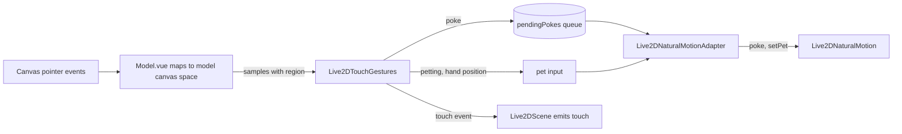

# Live2D touch interaction: poke and pet

Date: 2026-10-18
Status: accepted

## Decision and scope

The user can poke the Live2D character and pet its head with the desktop cursor, and the Natural motion driver reacts at once.
Touch is a Natural reaction only. Universal and MAGIC ignore it, because the rigs this fork targets declare no hit areas and no tap motions, so a fallback would have nothing to play.
The chat model does not react to touch yet. The scene emits a `touch` event so that a later change can send it through `spark:notify`.

This ADR records the contracts that cross component and package boundaries:

- the gesture classifier `Live2DTouchGestures` and its event type;
- the touch regions and how they are measured;
- the adapter inputs `pendingPokes` and `pet`, and the controller methods `poke` and `setPet`;
- the `touch` event of `Live2DScene`;
- the two settings;
- the change to cheek ownership in the [Natural motion v2 ADR](2026-10-17-natural-motion-v2-performance-state.md).

## Data flow

## Gestures

`Live2DTouchGestures` is a pure class. It takes press, move, release, and cancel samples, and `update` calls, all on one monotonic millisecond clock, and returns `poke`, `pet-start`, and `pet-end` events.
A sample carries a position in model canvas space, its region (`head`, `body`, or `null` off the model), and a scale: the head width when the model has a head, otherwise the body width.
Every distance threshold is a share of that scale, so the gesture does not depend on how large the character is drawn.

- A poke is a press released within 400 ms that moved less than 0.05 of the scale. It needs a press over the model.
- A pet starts when the head-region movement in the last second travels at least 0.5 of the scale. Without `requireHold` the movement must also reverse direction once. With `requireHold`, only movement while the button is held counts, and the press that becomes a pet is not a poke.
- A pet ends after 600 ms without head movement, 250 ms after the pointer leaves the head, on release under `requireHold`, or on cancel.

The scene calls `update` once per rendered frame while a pet is in progress, because a resting pointer produces no event.

## Regions

The head is `createLive2DHeadTracker().bounds`, which the presence bubble already uses: the `head` or `face` hit area, or otherwise the drawables that move when the head angles turn.
Both target rigs declare no hit area and define `ParamAngleX/Y/Z`, so the second rule applies to them.
A model that states neither has no head; it can be poked but not petted.
The tracker measures the real head. A per-model setting scales that box around its center (0.5 to 2, default 1) for a rig whose measured head is too tight or too loose for petting.

The body is `live2DVisibleBounds`: the box around drawables whose visible flag is set and whose opacity is at least 0.01.
The padded model canvas is not used, because its size says little about where the character is.
The head wins where the boxes overlap. Both boxes are re-measured at most every 100 ms while the pointer moves.

A poke inside a box can land on a transparent pixel in the web host. In the Electron stage window the click does not reach the canvas there, because the window is click-through over transparent pixels.

## Controller and adapter contract

`Live2DNaturalMotion.poke(region, x, nowSeconds)` queues a poke, where `x` is the poke position across the touched box, -1 left to 1 right.
At the next grid step the head receives a nudge away from the poke and upward (head intensity 2.5, body 1.5), a surprise impulse starts (head 1, body 0.6), and the gaze glances at the camera for 0.9 s.
The nudge exceeds the emotion range on purpose. At intensity 1 a head poke lifted the head about 2 degrees on the stage, which was barely visible.
A repeated poke within 2 s still nudges, but the surprise impulse is deduplicated like every emotion.

`Live2DNaturalMotion.setPet(hand, nowSeconds)` starts or continues a pet with the hand at `hand` across the head box, or ends it with `null`.
`NaturalPetLayer` keeps a level that rises with a 0.35 s time constant and falls with 0.7 s.
At full level it multiplies eye openness by 0.25, adds 0.7 eye smile, 0.4 mouth form, 0.6 cheek, and 0.15 brow raise, bows the head by 0.12, rolls it by up to 0.22 with the hand, and scales posture amplitude to 0.4.
While a pet is in progress, the controller passes a null cursor to gaze and to the cursor head bias.

The pet layer draws no random numbers and is exactly neutral at level 0: zero offsets and unit multipliers.
A controller that is never petted therefore produces the same output as before this change, and a test asserts it.

`Live2DNaturalMotionAttention` gains `pendingPokes`, a queue the adapter empties on every composition, and `pet`, the current hand position or `null`.
The adapter forwards pokes only while Natural is active and passes `null` to `setPet` otherwise, following the rule for queued emotions: touch from while Natural was inactive is stale.

## Ownership change

The Natural motion v2 ADR reserves the cheek channel and has Natural write it with a 0 offset.
This ADR supersedes that rule: the pet layer raises the cheek. Every other ownership rule is unchanged.
The eyelid floor still applies, so a pet never closes open lids below 0.2. Physics outputs, clip-owned face channels, and the mouth during speech remain untouched.

## Scene event and settings

`Live2DScene` re-emits `touch` from its model for every poke, pet start, and pet end. No consumer reads it in this change.

| Key | Default | Meaning |
| --- | --- | --- |
| `settings/live2d/natural-touch` | `true` | Touch reactions are enabled while Natural drives the model. |
| `settings/live2d/natural-touch-pet-requires-hold` | `false` | Only strokes with the primary button held count as petting. |
| `settings/live2d/natural-touch-head-scale` | `{}` | Head box scale by stage model id; a model without an entry uses 1. |

Both reset with the other Live2D settings.

## Tuning

Every threshold, time constant, and pose value is a named constant in `touch-gestures.ts` or `natural-motion/touch.ts`.
They are starting values chosen without reference recordings. In particular, the roll direction of the pet was not checked against a recording, and should be checked on the target rigs.
