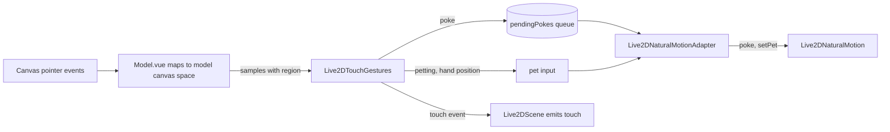

# Live2D touch interaction: poke and pet

Date: 2026-10-18
Status: accepted

## Decision and scope

The user can poke the Live2D character and pet its head with the desktop cursor, and the Natural motion driver reacts at once.
Touch is a Natural reaction only. Universal and MAGIC ignore it, because the rigs this fork targets declare no hit areas and no tap motions, so a fallback would have nothing to play.
The chat model does not react to touch yet. The scene emits a `touch` event so that a later change can send it through `spark:notify`.

This ADR records the contracts that cross component and package boundaries:

- the gesture classifier `Live2DTouchGestures` and its event type;
- the touch regions and how they are measured;
- the adapter inputs `pendingPokes` and `pet`, and the controller methods `poke` and `setPet`;
- the `touch` event of `Live2DScene`;
- the two settings;
- the change to cheek ownership in the [Natural motion v2 ADR](2026-10-17-natural-motion-v2-performance-state.md).

## Data flow

## Gestures

`Live2DTouchGestures` is a pure class. It takes press, move, release, and cancel samples, and `update` calls, all on one monotonic millisecond clock, and returns `poke`, `pet-start`, and `pet-end` events.
A sample carries a position in model canvas space, its region (`head`, `body`, or `null` off the model), and a scale: the head width when the model has a head, otherwise the body width.
Every distance threshold is a share of that scale, so the gesture does not depend on how large the character is drawn.

- A hover poke commits at 90 ms while the press is held and remains eligible, or on an earlier eligible release within 400 ms and 0.05 scale units of travel. With `requireHold`, a poke commits only on an eligible release within 400 ms and 0.05 scale units of travel.
- Before the poke commits, travel beyond 0.05 scale units permanently rejects that press as a drag, even if the pointer returns. Movement after a committed poke cannot undo it or create another poke from the same press.
- A pet starts when movement in a 1500 ms trail travels at least 0.35 head widths. Without `requireHold`, the movement must reverse direction once; with it, only held movement counts. At least half of the trail's elapsed time must lie inside the true head box. The trail can extend into a margin zone 0.5 head widths along the sides and above the head, and 0.15 below it. A press that becomes a pet is no longer eligible to poke.
- The idle clock refreshes when displacement from its current movement anchor reaches 0.03 scale units, rather than on each pointer sample, so it is independent of sample rate.
- A pet ends after 600 ms without head movement, 250 ms after the pointer leaves the expanded margin zone when head geometry is available (or leaves the head region when it is not), on release under `requireHold`, or on cancel.

The scene calls `update` once per rendered frame while a pet is in progress or a poke press is pending. A resting pointer produces no event, so these frame updates end idle pets and commit eligible hover pokes.

## Regions

The presence bubble uses `createLive2DHeadTracker().bounds`: an authored `head` or `face` hit area, or otherwise visible drawables moved by head-angle parameters with physics included.
Touch uses the interaction box instead: an authored hit area first, then a face-feature measure, then the physics-inclusive head box. The face measure selects visible drawables moved by the rig's eye-open, eyeball, brow, and mouth parameters, without settling physics; parameter presence is checked against the real parameter table because Cubism can return virtual indices for absent ids.
The face-feature box expands around its center by `faceToHeadScale` (1.6) to make the interaction box. The per-model setting scales this resulting box around its center (0.5 to 2, default 1) when it is too tight or loose for petting.
A model without any available head measure can be poked but not petted.

The body is `live2DVisibleBounds`: the box around drawables whose visible flag is set and whose opacity is at least 0.01.
The padded model canvas is not used, because its size says little about where the character is.
The head wins where the boxes overlap. Both boxes are re-measured at most every 100 ms while the pointer moves.

A poke inside a box can land on a transparent pixel in the web host. In the Electron stage window the click does not reach the canvas there, because the window is click-through over transparent pixels.

## Controller and adapter contract

`Live2DNaturalMotion.poke(region, x, y, nowSeconds)` queues a poke, where `x` and `y` are relative to the touched box center, from -1 to 1, with positive `y` downward.
At the next grid step the head receives a nudge away from the poke; a top-of-head poke pushes down, while other pokes lift. Head and body nudge strengths are 2.5 and 1.5, and surprise strengths are 1 and 0.6. The nudge time constant is drawn from 0.12 to 0.18 s, and the gaze glances at the camera for 0.9 s. A repeated poke within 2 s still nudges, but the surprise impulse is deduplicated.
The nudge exceeds the emotion range on purpose. At intensity 1 a head poke lifted the head about 2 degrees on the stage, which was barely visible.

`Live2DNaturalMotion.setPet(hand, nowSeconds)` starts or continues a pet with the hand at `hand` across the head box, or ends it with `null`. The hand carries both horizontal and vertical position. The head bows with lower strokes as well as rolling with horizontal strokes.
`NaturalPetLayer` keeps a level that rises with a 0.35 s time constant and falls with 0.7 s.
At full level it multiplies eye openness by 0.25, adds 0.7 eye smile, 0.4 mouth form, 0.6 cheek, and 0.15 brow raise, bows the head by 0.12, rolls it by up to 0.22 with the hand, and scales posture amplitude to 0.4.
The controller transfers cursor attention continuously into the hand as petting begins and fades the hand response out at the end. It does not clear the cursor by passing a null cursor to gaze or head bias.

The pet layer draws no random numbers and is exactly neutral at level 0: zero offsets and unit multipliers.
A controller that is never petted therefore produces the same output as before this change, and a test asserts it.

`Live2DNaturalMotionAttention` gains `pendingPokes`, a queue the adapter empties on every composition, and `pet`, the current hand position or `null`.
The adapter forwards pokes only while Natural is active and passes `null` to `setPet` otherwise, following the rule for queued emotions: touch from while Natural was inactive is stale.

## Ownership change

The Natural motion v2 ADR reserves the cheek channel and has Natural write it with a 0 offset.
This ADR supersedes that rule: the pet layer raises the cheek. Every other ownership rule is unchanged.
The eyelid floor still applies, so a pet never closes open lids below 0.2. Physics outputs, clip-owned face channels, and the mouth during speech remain untouched.

## Scene event and settings

`Live2DScene` re-emits `touch` from its model for every poke, pet start, and pet end. No consumer reads it in this change.

This scene event is distinct from the controller's optional `NaturalMotionObserver`. When attached, the observer reports controller events on the active-time grid. Its `touch` event has `touch: 'poke' | 'pet-start' | 'pet-end'` and an optional `region: 'head' | 'body'`; its `attention` event has `phase: 'notice' | 'engage' | 'release' | 'dismiss'` and cursor distance in head widths. The observer reports performed controller changes, while the scene event re-emits the gesture classifier's touch event, including its gesture data such as pet duration.

The motion-scenario event schema also accepts `pointer` events with `move`, `down`, `up`, and `leave` phases. Coordinates are head widths from the head-box center, with positive Y downward. When a scenario includes both `cursor` and `pointer`, the most recent event by time supplies the cursor state. T3 scenarios reject pointer events, because the rendered app cannot inject pointer input through the QA bridge.

| Key | Default | Meaning |
| --- | --- | --- |
| `settings/live2d/natural-touch` | `true` | Touch reactions are enabled while Natural drives the model. |
| `settings/live2d/natural-touch-pet-requires-hold` | `false` | Only strokes with the primary button held count as petting. |
| `settings/live2d/natural-touch-head-scale` | `{}` | Head box scale by stage model id; a model without an entry uses 1. |

Both reset with the other Live2D settings.

## Tuning

Every threshold, time constant, and pose value is a named constant in `touch-gestures.ts` or `natural-motion/touch.ts`.
They are starting values chosen without reference recordings. In particular, the roll direction of the pet was not checked against a recording, and should be checked on the target rigs.
