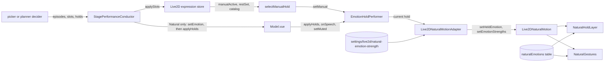

# Natural emotion revamp: held emotions and gestures

Date: 2026-10-19
Status: accepted

## Supersedes

This ADR supersedes these parts of earlier ADRs:

- `docs/ai/adr/2026-10-18-expression-performance.md`, non-goal "No gesture library and no second settings document": Natural now has gesture clips. The rest of that non-goal still holds, because the held-emotion tunables live in the existing settings document.
- `docs/ai/adr/2026-10-18-expression-performance.md`, the Natural band table: with `heldEmotions` on, the body also moves at clear, and emotions that have a gesture suppress the impulse head pulse and body lean. Gesture admission is decided separately, so a cooling-down gesture can be skipped while both impulse motions remain suppressed.
- `docs/ai/adr/2026-10-17-natural-motion-v2-performance-state.md`, non-goal "Only the Energy slider and the cursor attention toggle are user-facing": Settings also show per-model emotion strength sliders and the held-emotions switch.

## Context

On the rigs this fork is tuned on, every emotional `.exp3.json` drives one decoration switch parameter, such as an anger mark, tears, hearts, a blush, or sleepy marks. None of them moves the brows, eyes, or mouth.
Before this change, Natural showed an emotion only as an impulse: short face hints that released after the band's `faceHold`, plus a head pulse. A slot lease of a mapped stamp lasted for the whole speech turn, so the stamp sat on a neutral face for most of it.
An explicit expression from the LLM, and a manual preview toggle in Settings, told Natural nothing about the emotion that the stamp shows.
The body leaned only at the strong band, and every emotion used the same pulse shape.

## Decision and scope

Natural performs each emotion as a held state of the whole face and body, with short emotion-specific gesture clips on top.
The decider emits a hold next to each episode, a performer gives the hold a lifetime, and a Natural layer renders it.

This ADR records:

- the `HoldCommand` contract and the rules that emit holds;
- conductor routing of holds;
- the hold performer and its preview source;
- the Natural hold layer, the gesture clips, and how they compose with the other layers;
- the per-emotion table;
- the per-model emotion strength setting and the `heldEmotions` switch;
- the `love`, `flustered`, and `sleepy` emotions and their fallbacks on other renderers.

## Architecture

## Hold contract

`HoldCommand` in `packages/stage-shared/src/expression-performance/types.ts` has these fields:

| Field | Meaning |
| --- | --- |
| `emotion` | A `PerformanceEmotion`, or `null` to release the hold. |
| `strength` | The held strength in [0, 1]. |
| `holdSeconds` | The hold time, as in a slot command. |
| `until` | `'speech'` or `'hold'`, with the same lease rules as slot commands. |
| `turnId` | Copied from the signal, so a speech-bound hold stays inside its turn. |

`PerformanceDecision` has the required field `holds: HoldCommand[]`. Both deciders emit holds with these rules:

- An accepted emotion episode, including an escalation, emits a hold with the episode's emotion and intensity. With a turn id, the hold uses the band's `naturalBands.<band>.faceHold` and `until: 'speech'`. Without one, it uses `held.turnlessSeconds` and `until: 'hold'`.
- A `neutral` emotion that resets the reaction state emits a release hold.
- A `clear` without a slot emits a release hold. A `clear` that names a slot emits none.
- An `expression` signal whose catalog entry has emotion mappings derives a reaction through `explicitExpressionReaction` in `packages/stage-shared/src/expression-performance/selection.ts`:
  - The primary mapping is the one with the highest weight, the earliest one on ties.
  - `acceptReaction` accepts it like a direct emotion at the intensity of the mapping's `minBand`, or at 0.6 when `bands` is off.
  - A new episode is returned like any other episode. No automatic picks run, because the expression is the pick.
  - The decision always carries one hold for the primary emotion. Its `holdSeconds`, `until`, and `turnId` match the explicit slot command, so the held face lasts exactly as long as the stamp.
- With `heldEmotions` off, or for an entry without mappings, an expression signal keeps the slot-only behavior and leaves the reaction state unchanged.

Deciders stay pure. Holds are part of the decision, so `replayAffectTrace` reproduces them. The trace signal schemas changed only by the three new emotion names.

## Conductor routing

`StagePerformanceConductor` in `packages/stage-ui/src/composables/performance/use-stage-performance-conductor.ts` routes holds only for the Natural driver:

- For the emotion, expression, clear, timing, and deadline paths, it sends the decision's episodes to `setEmotion` first. When the decision has holds, it then sends the current muted flag through `setMuted` and the holds through `applyHolds`.
- An explicit expression now also sends its derived episode to Natural.
- Outside Natural, the effective decider context sets `heldEmotions` to false. The stored document is not changed. Explicit expressions then derive no reaction state, and Universal and MAGIC slot decisions match their previous behavior.

## Hold performer

`EmotionHoldPerformer` in `packages/stage-ui-live2d/src/composables/live2d/expression/hold.ts` turns hold commands into one current hold. Each mounted `packages/stage-ui-live2d/src/components/scenes/live2d/Model.vue` owns one performer:

- A hold command becomes a lease built with the slot lease functions in `packages/stage-ui-live2d/src/composables/live2d/expression/slots.ts`. The speech, hold, muted, `clip-stopped`, and `slots.holdCap` rules of slot leases apply unchanged. A newer hold replaces the older one.
- The performer remembers which turns are speaking. A hold that starts after its turn's first clip start lasts through that clip instead of expiring as unstarted.
- A command with a non-finite or negative `holdSeconds`, a non-finite strength, or an unknown `until` is dropped with a warning.
- `current(now)` releases an expired lease when it is read. The manual source wins while it is set, and the lease resumes when it clears.
- Hold times use the conductor's clock, `performance.now() / 1000`, not Natural's active time.
- The model releases the lease when it loads another model and when it is destroyed, so the next model never inherits a held face.

The manual source previews Settings toggles. `selectManualHold` picks the most recent manually active expression that is not in the rest set and has a mapping. It uses that entry's primary mapping, with the strength `intensity[minBand]` from the performance settings. Saved defaults are in the rest set, so they never preview an emotion.

## Natural hold layer

`NaturalHoldLayer` in `packages/stage-ui-live2d/src/composables/live2d/natural-motion/hold.ts` renders the current hold:

- `set` ignores a hold with a non-finite strength or an unknown emotion. An emotion without a held recipe, such as `neutral`, counts as no hold. Strength is clamped to [0, 1].
- The effective strength is the hold strength times the model's strength for that emotion. A strength of 0 produces no output.
- Each face, posture, and modulation channel moves toward its target with an exact exponential step: `held.onsetTau` while a hold is active, `held.releaseTau` after release, and `held.postureTau` for posture. A switch from one emotion to another starts from the current values, so it never jumps.
- The side of sided posture axes and of a one-sided brow comes from a hash of the emotion name plus a change counter. The layer draws no random numbers.
- With no hold and a settled level, every output is exactly neutral: zero offsets and unit multipliers.

`Live2DNaturalMotion` in `packages/stage-ui-live2d/src/composables/live2d/natural-motion.ts` composes the layer only while `heldEmotions` is on:

- The hold layer steps after mood.
- Its modulation applies after the energy and mood adjustments. It scales posture amplitude, adds to camera fixation probability and to the desk gaze weight, adds to speech emphasis acceptance, and sets the blink interval, breath period, and emphasis size scales. Turning `heldEmotions` off returns those three scales to 1.
- The held posture is added to the head and to the body follower's input, so the body follows the held bias at every band.
- The held face is added to the face output.

The decided layer priority is pet, then hold, then accent, then mood. The facade implements it this way:

- A pet scales the held contribution by `1 - pet.level` on eye openness, brow height (including a one-sided raise), eye smile, mouth form, and cheek. Brow angle and the held silent mouth opening are not scaled.
- Impulse face hints of the held emotion are scaled by `1 - held.accentScale * level`, so a repeat accent does not saturate the face. Hints of other emotions are not scaled.
- Mood keeps its additive mouth-form tint and its modulation. Held modulation applies after it.

## Gesture clips

`NaturalGestures` in `packages/stage-ui-live2d/src/composables/live2d/natural-motion/gestures.ts` plays short head clips: laugh, recoil, shake, drop, sway, tilt-in, look-away, and nod-off. Angry plays shake or drop with equal chance.

- A clip starts only at the clear or strong band with a positive strength, and only outside its cooldown. With `bands` off, gestures use the clear band.
- A clip draws all its parameters once, at trigger time, from the new random stream `gestures: 12`. Stream indices 0 to 11 keep their meaning. A refused trigger draws nothing.
- Every clip returns to exactly 0 at the end of its lifetime.
- The body follows a clip only at strong, at half the head amplitude on yaw and roll.
- When a posture shift falls due while a clip has more than 0.5 s left, the shift is postponed by the clip's remaining time.
- While a clip is active, idle continuous posture motion ducks so the clip is not masked by jitter. `NaturalGestures.continuousScale(time)` returns `1 - depth` of the deepest live clip, where `depth = 0.45 x min(1, strength) x band amplitude` (0.45 at strong with full strength, 0.27 at clear). The scale eases in over 0.15 s with a min-jerk profile, holds until the clip's active span ends, and eases back over 0.3 s (`gestureDuckRelease`). The active span is the first age after the clip's peak from which its head offset stays under 10% of the peak, capped at 2 s; it is not the clip lifetime. Overlapping clips take the deepest window, not the sum.
- The facade sets `posture.continuousScale` immediately before each posture step, only with `heldEmotions` on, and posture applies it to the continuous term only: `amplitudeScale * (continuousScale * gain * continuous + shift)`. Drift, posture shifts, the gesture clip, and the shift postponement rule are not scaled. The scale draws no random values. With no clip active it is exactly 1, so idle output is bit-identical to before. A clip triggered in a call is first reflected on the next grid step, because the trigger runs after that call advanced the controller; the ease-in starts at 0, so no step is skipped.
- `naturalEmotionLifetime` adds `gestureDuckRelease` to the longest gesture clip, so QA windows clear the duck release too.

For an emotion with a gesture, the impulse keeps its random draws, face hints, glance, and mood dose, but adds no head pulse or body lean. The gesture clip takes their place.
The impulse drops them even when the gesture does not start. While that gesture is cooling down, for example on a repeat or an escalation soon after the last clip, the episode adds no head clip, head pulse, or body lean.
Emotions without a gesture keep the impulse head pulse and the strong-band body lean.

## Per-emotion table

`naturalEmotions` in `packages/stage-ui-live2d/src/composables/live2d/natural-motion/emotions.ts` is the single per-emotion table. It satisfies `Record<PerformanceEmotion, NaturalEmotionSpec>`, so a missing emotion fails typecheck. Each entry has:

- `impulse`: the head direction, sided axes, face hints, one-sided brow, and glance of the impulse;
- `mood`: the valence, arousal, and tension coefficients;
- `held`: the `HeldSpec` face, posture, sided axes, and modulation of the held state;
- `gesture`: the gesture clip kind.

Neutral has only zero mood coefficients. Sad, think, question, and curious have no gesture.
The file holds the values, and this ADR does not copy them. The held values are starting points, and rendered QA may retune them in that file.
`HeldSpec` face values are in adapter face units. `eyeOpenMultiplier` is a multiplier that equals 1 at rest, and the other face values are offsets that equal 0 at rest. Modulation multipliers equal 1 at rest, and `cameraFixation`, `deskWeight`, and `nodAcceptance` are deltas that equal 0 at rest.

## Settings

The performance settings document in `packages/stage-shared/src/expression-performance/settings.ts` gains two fields:

- `heldEmotions`, default `true`. Off keeps the earlier momentary emotion behavior: Natural renders no hold, no gesture, and no held posture, and explicit expressions derive no reaction.
- `held`: `turnlessSeconds` (default 4), `onsetTau` (0.25), `releaseTau` (0.6), `accentScale` (0.5, from 0 to 1), and `postureTau` (0.6). The settings page has no controls for these.

Both fields are optional with defaults, so stored documents without them still parse.
The Live2D settings page shows a Held emotions checkbox among the performance switches.

The per-model emotion strength is stored in `localStorage` as `settings/live2d/natural-emotion-strength`, a record from stage model id to per-emotion values from 0 to 2:

- A missing model or emotion means 1. While `heldEmotions` is on, a value of 0 turns that emotion's Natural performance off: Natural skips the episode's impulse, gesture, and mood dose, and the hold renders nothing. With `heldEmotions` off, Natural ignores the strengths.
- Reading drops entries that are not finite numbers, clamps the rest, and drops a model that is left without entries.
- While Natural is selected, the settings page shows a collapsible Emotion strength group with one slider per emotion except neutral, and a reset button that removes the selected model's entry.
- Resetting Live2D settings clears the record.

## New emotions and fallbacks

`love`, `flustered`, and `sleepy` join every closed emotion list: the stage emotion enums, `PerformanceEmotion`, the catalog mapping picklist, the reaction guard, the trace picklist, and the ACT payload parser. The runtime prompt lists them as Love, Flustered, and Sleepy, and the lines of the nine earlier emotions are unchanged. The Natural lab offers pulses for them.

Other renderers use the nearest earlier emotion:

| Renderer | love | flustered | sleepy |
| --- | --- | --- | --- |
| Live2D Universal and MAGIC motion group | Happy | Awkward | Idle |
| VRM expression | happy | neutral | relaxed |
| Spine animation | Happy's | Awkward's | Neutral's |
| MMD action and morphs | Happy's | Awkward's | Neutral's |
| Tachie image | happy | awkward | neutral |

## Consequences

- A mapped stamp never shows on a neutral face, whether an ACT marker, a tool call, an automatic pick, or a preview toggle shows it. An explicit request or a toggle of an entry without mappings gets no held face, so the catalog mappings decide which stamps carry an emotion.
- A saved default, such as a Blush expression in the rest set, never holds its emotion. Only a manual toggle previews it.
- At the clear band the body now leans through the held posture.
- With no emotion, Natural output stays bit-identical to the earlier controller, and the gesture stream draws nothing. With `heldEmotions` off, emotion output equals the earlier behavior.
- Universal, MAGIC, VRM, MMD, Spine, and Tachie behavior for the nine earlier emotions is unchanged.
- Replayed affect-trace decisions now include holds.

## Test plan

- `packages/stage-shared/src/expression-performance/holds.test.ts` covers hold emission by both deciders, derived expression reactions, and replay of holds.
- `packages/stage-ui-live2d/src/composables/live2d/expression/hold.test.ts` covers lease lifetimes, the manual source, invalid commands, and `selectManualHold`.
- `packages/stage-ui-live2d/src/composables/live2d/natural-motion/hold.test.ts` and `packages/stage-ui-live2d/src/composables/live2d/natural-motion/scale-hooks.test.ts` cover onset, release, switch continuity, strength scaling, and identity at scale 1.
- `packages/stage-ui-live2d/src/composables/live2d/natural-motion/gestures.test.ts` covers determinism, cooldowns, bounds, and the strong-only body.
- `packages/stage-ui-live2d/src/composables/live2d/natural-motion.test.ts` covers idle bit-identity, the switch off, held offsets, the clear and strong body, release, pet priority, accent scaling, and strength 0.
- `packages/stage-ui-live2d/src/composables/live2d/natural-motion-adapter.test.ts` covers inactive holds and strength changes between frames.
- `packages/stage-ui/src/composables/performance/use-stage-performance-conductor.test.ts` covers hold dispatch by driver.
- `packages/stage-ui/src/components/scenarios/settings/model-settings/live2d.browser.test.ts` covers the strength sliders, their reset, and the Held emotions checkbox.

## Non-goals

- No per-parameter recipe editor, no character-card fields for held emotions, and no controls for the `held` tunables.
- No change to Universal or MAGIC behavior for the nine earlier emotions. Other renderers gain only fallback entries.
- No writes into rig files, `.model3.json`, or `.vtube.json`.
- No new random draws and no changed draw order on the idle path.
