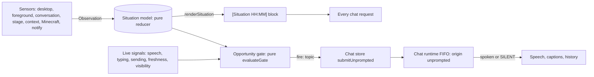

# Situational presence

Date: 2026-10-19
Status: accepted

## Context

The character sits in a corner of the desktop while the user games, works, or browses. Before this change she only answered. Four gaps kept her from feeling present:

1. She knew nothing about the desktop. Ambient context reached the model as a raw `[Context]` dump of every source bucket, with no time, salience, or budget. Desktop signals never reached the prompt, and nothing sampled the foreground app.
2. She never spoke first. `performSend` dropped a turn without text, always committed a user message, and attached runtime context only to a trailing user turn. No component decided when speaking up would be welcome.
3. Plugin notifications bypassed the conversation. The first design discussion assumed that `spark:notify` reactions were not spoken. That was wrong: the character store spoke them through its own `Speech` client with the `notification` purpose, so text-to-speech, ACT cues, and captions did run. The real gap was that a reaction was never stored in chat history, was not paced against other turns, did not show as `sending`, and ran as a separate model call outside the session. She forgot what she said, and the user could not see or answer it.
4. The body channel and the persona did not belong to the character. ACT parsing accepted only the JSON form, so weaker local models lost their cues. A Live2D ACT that named a motion skipped its emotion. The upstream ACT rules and a shared closing line rode every character card in each user turn.

## Decision

### Four layers

Situational presence has four layers:

- Sensors turn host signals into typed `Observation` values.
- The situation model folds observations into a `SituationState` and renders a bounded block.
- The opportunity gate decides when a moment exists. The model decides whether to speak and what to say, and it can decline with `<|SILENT|>`.
- Delivery uses the existing per-session FIFO of `createChatOrchestratorRuntime`. The runtime has no second queue or scheduler.

### Situation model and block

`@proj-airi/stage-shared/situation` owns the pure core: the types, `reduceSituation`, `advanceSituation`, `markShown`, `markAddressed`, `renderSituation`, `evaluateGate`, and the window-title helpers.
Every function takes time as an argument and never reads a clock or randomness. Time is clamped so that it never runs backwards.
Each constant is a starting value with a `Tuning:` note. None has been measured against real sessions.

The reducer applies these rules:

- A new foreground app becomes current at once. Its `app-switch` event exists only after the app stays in front for 75 s. A switch back within 30 s merges with no event, and three or more switches within 2 minutes yield one `switching between A and B` event.
- Long sessions emit one `long-session` event per tier, at 30 minutes and at 1, 2, and 3 hours.
- A `went-away` event exists only after the user has been away for 5 minutes, and coming back after that emits `returned`. A lock that ends at once therefore creates no away topic.
- A `wake` observation emits a `wake` event only when the away span that it ends lasted at least 5 minutes. The span runs from the start of the current away span, or it is the span that just ended when the return was reported before the wake. A one-second lock therefore creates neither an away topic nor a wake topic. A wake with no away span to measure still emits the event.
- A context observation replaces the text of its source and emits an event only when the text changed.
- A notify observation emits one event per `notifyTopicKey(sourceKey, eventId)`.
- Observations caused by the character's own turns are tagged with the origin `self`, and the gate never picks them as topics.
- The ring keeps the 32 newest events. An event whose effective salience falls below 0.05 is dropped.

Each event carries two mention flags that code sets: `shownAtMs` when a block first renders it as `New:`, and `addressedAtMs` when its topic is addressed. The gate addresses a topic when it fires on it. Every spoken unprompted turn addresses its trigger topic at its first literal, and a declined unprompted turn addresses it when its stream ends. The model keeps no bookkeeping marker.

`renderSituation` produces one block: a `[Situation HH:MM]` header, then at most 6 lines and 500 characters of flat bullets.
The bullets are presence, the current and previous app, up to two unshown `New:` events with relative times, one conversation line, one line per context source, and the stage line with exposed expressions and mood.
A context change that already has its own context line is shown once, not also as a `New:` event.
The conversation line names the topic of her previous spoken unprompted remark. It never names the topic that the gate is about to raise.

The block is the only ambient-context channel. The chat store registers one runtime context provider, which returns the leader's rendered block, and `core-agent` renders runtime context entries verbatim without a `[Context]` header.
Conversation history stays verbatim and ordered. The block and window titles are never stored in chat history.
Messages that the user addresses to her bypass the gate.

`useSituationStore` in `@proj-airi/stage-ui` holds the state in memory, in the leader window only. It is neither synced nor persisted.
A promoted leader starts from `initialSituationState`, and a demoted window drops its state. Nothing survives a restart.

### Sensors

Every context source became a sensor adapter. No `[Context]` passthrough remains for any source.

| Sensor | Source | Observations |
| --- | --- | --- |
| Desktop | `useDesktopActivityStore` snapshot | `presence` (here, idle after 60 s, away after 300 s or when locked or suspended, unknown when the sample is older than 5 s or missing) and `wake` |
| Foreground | `useForegroundWindowStore` sample | `activity` and `busy` |
| Conversation | chat hooks | `conversation`, counting user turns only for user-origin sends |
| Stage | live expression and mood state | `stage` |
| Context | plugin `context:update`, vision, and `input:text` context updates through the context bridge | `context` |
| Minecraft | `useMinecraftStore` runtime context | `context` with the source `system:minecraft-integration` |
| Notify | `spark:notify` through `notifyObservationFrom` | `notify` |

The foreground sensor is Windows-only and has three parts:

- `packages/electron-eventa` defines the invoke `electron.foregroundWindow.sample` as `eventa:invoke:electron:foreground-window:sample`. It returns a `ForegroundWindowSample` or `null`.
- `createForegroundWindowService` in the Electron main process answers it with synchronous koffi calls to `GetForegroundWindow`, `GetWindowTextW`, `GetWindowThreadProcessId`, `QueryFullProcessImageNameW`, and `SHQueryUserNotificationState`. It loads koffi lazily, closes every process handle, and never logs titles. A sample has `ownProcess: true` for the main process, every process in `app.getAppMetrics()`, and the Godot stage sidecar.
- The renderer producer polls once per second, also while the stage is hidden or minimized, and writes the sample into the stage-shared holder. The stage window runs it only while the `shareForegroundWindow` setting is true. Stopping it clears the sample, so no FFI call runs while sharing is off.

The adapter applies the privacy and freshness rules:

- It skips samples with `ownProcess: true`, so AIRI's own windows never reach the model.
- An app on the title denylist is reported by its app name and category with a `null` title.
- A sample is fresh for 5 s while the stage is visible and for 20 s while it is hidden or minimized, because Chromium throttles timers in a minimized window. An older sample reports busy `unknown` and clears the foreground category.
- While `shareForegroundWindow` is false, the adapter treats every sample as missing and clears the foreground category. The leader's situation drops the current and recent apps, their app-switch, long-session, and switching-burst events, and the busy state (`forgetForeground`). The gate reads the foreground signal as stale.

### Opportunity gate and model veto

`evaluateGate` is pure. It checks, in order:

1. The hard suppressors: `disabled`, `dont-disturb`, `stage-hidden`, `presence-away`, `presence-unknown`, `stale-signal`, `user-speaking` (also when unknown, and while speech-to-text still finishes what the user said), `user-typing`, `character-speaking`, `generating`, `queued`, `busy-*` for the Windows notification states that block speech, including the `unknown` state, `quiet-app` for calls and the quiet-app list, and `busy-game` when **Speak during games** is off.
2. The best topic: a world-origin event that is not addressed and whose effective salience reaches `0.65 - 0.5c`, where `c` is Chattiness. Otherwise the decision is `no-topic`.
3. The urgent bypass: an immediate notify or a critical reminder skips the timing guards and `busy-game`, never another hard suppressor.
4. The timing guards: `in-exchange` within 120 s of a user turn, `gap` within `max(3, 20(1 - c))` minutes times `2^backoffLevel` of the last fire, doubled while a game is in front, and `hourly-cap` at `round(1 + 6c)` fires per hour. At the default Chattiness of 0.5, this allows about four remarks an hour with gaps of at least 10 minutes.

Engagement drives the backoff. A spoken fire without a user turn within 120 s counts as ignored, and a decline counts half. Two ignored fires raise the backoff level by one, up to 3. A user turn within the window lowers it by one.
A new leader uses `promotionGateMemory`, and a stage that becomes visible again uses `visibilityRegainGateMemory`. Both act as if a turn had just fired, so neither causes a burst.

The leader runs the gate every 2 s, only in a host that called `setHostCapabilities({ unprompted: true })`. The Electron app calls it; stage-web and Pocket never do.
The Electron app also reports stage visibility through `setStageVisible`, and a host that never reports it counts as hidden.
User typing comes from `chatComposerActivityChangedEvent` on the speech bus, which every composer window emits. Character speech comes from `voiceTurnsChanged`.
On a fire, the store addresses the topic first, then calls `submitUnprompted`, and starts no other turn until that one has a result.
The gate never picks a topic that a widget reaction holds (see Plugin notifications).

### Unprompted turns in the runtime

`ChatOrchestratorSendOptions` gains `origin`, `trigger`, and `declineMarker`. User-origin turns behave exactly as before.
For `origin: 'unprompted'`:

- The trigger message reaches the provider as the trailing user turn, so the situation block attaches to it. The runtime commits the trigger only when the reply is decided as spoken, at its first non-whitespace literal.
- Until that decision, the runtime buffers literal and special hooks and publishes no assistant message.
- The decline marker (`<|SILENT|>` by default) before any speech, or a reply without visible speech, declines the turn. A declined turn commits nothing, calls `emitStreamEndHooks` and `onTurnDeclined`, and settles with the status `declined`.
- On decline, the runtime stops the provider request at once, so `sending` clears and no more tokens are spent. The stop is not reported as a cancellation or an error.
- An unprompted turn carries no tools. The stage-ui LLM layer sends no built-in or custom tools, and the Responses adapter adds no hosted `web_search`.
- The stream context reports `origin` and per-turn `cueStats`.

`useChatStore().submitUnprompted` is a leader-routed synced action. It sends to the leader's active session with the trigger text `(No one spoke to you. You may speak up about: <topic>)` and the `base.prompt.unprompted` instruction, or `base.prompt.unprompted-forced` when `force` is set.
At most one unprompted turn is pending at a time. A user send in the same session cancels a queued or generating unprompted turn.
A decline writes an `unprompted-declined` control record, which never reaches a prompt. The session store deduplicates control records and keeps the newest 50, of which only the newest 10 declines. Declines therefore stop growing the synced session, and they never push out the voice interruptions that later requests read.
Unprompted trigger messages and their replies are excluded from cloud sync.
`userSending` excludes unprompted turns, so the presence bubble, the streaming placeholder, and the Think motion follow user turns only.
Chat history shows a muted "Spoke up about X" cue above the reply. The **Show unprompted cue** setting hides it, but the model still receives the trigger.

The protocol is unchanged. `origin` is a local runtime field, and the plugin-protocol and server-shared event unions gain no event.

### Plugin notifications

Every `spark:notify` becomes one `notify` observation, built only by `notifyObservationFrom`, and the gate decides whether she speaks about it.
The server channel routes a notify by its `route.destinations`, or by its `data.destinations` when it has no route envelope, and matches them against peer names, plugin and instance ids, and announced modules. Stage windows connect as `proj-airi:stage-tamagotchi` or `proj-airi:stage-web`, so a plugin reaches them with `proj-airi:stage-*`. The web extension puts that glob in `route.destinations` and keeps `data.destinations: ['character']`, so its video notify reaches the stage as a character-only notify. The Minecraft bridge puts the glob in `data.destinations`.
The leader remembers notify topic keys for its leadership, so a scheduler reminder that is re-sent after its event decayed is never raised twice.
Follower windows forward their notify observations to the leader through `situationNotifyObservedEvent`.
A notify addressed beyond `character` runs the spark-notify agent with the `commandsOnly` control: spark-command tools stay available, no tool choice is forced, and text output is ignored. A widget request with `forceSparkCommandResponse` also runs the commands-only agent, and that run forces the spark-command tool. `spark:command` events keep their ids, `parentEventId`, and destinations.

Widget reaction requests keep their request and response contract. A forced unprompted turn now answers them:

- The context bridge holds the topic key `notifyTopicKey(sourceKey, eventId)` with `holdTopic` before the notify enters the situation, and releases it when the reaction settles. The gate never picks a held topic, so it cannot raise the same notify while the reaction waits. A hold does not address the topic.
- A forced turn skips the gate, so the reaction first waits up to 20 s for a quiet moment. In a quiet moment the character has no open voice response, and the user is neither speaking into the microphone nor writing in a chat composer. Writing means a draft that is not sent, or composer input within the last 10 s. Every initialized window tracks these user-input reports from the speech bus, so the wait works in the window that serves the request. A user send during the wait goes first. When no quiet moment comes, the reaction returns `fallbackText` without a model call.
- The reaction then calls `submitUnprompted` with `force: true`, the held topic key, the message id `spark:<id>`, and the `appendSystemInstructions` (including the CALL manifest) as `supplement`. A user send after the turn started cancels it.
- It returns the spoken text, or `fallbackText` when the turn is declined, cancelled, or failed, or when another unprompted turn is pending. A request with `forceSparkCommandResponse` runs only the commands-only agent and returns `fallbackText`.
- A spoken reaction addresses its topic at its first literal. A declined reaction addresses its topic too, because staying silent was her decision and raising the topic later would contradict it. A cancelled, failed, or busy reaction leaves the topic unaddressed, so the gate may raise it later. A declined topic never becomes her last remark on the conversation line.
- A CALL in the reply reaches the performance handlers registered for `spark:<id>`, because the runtime turn id equals the message id.
- The client-role reaction timeout and the default `dispatchSparkNotifyPerformance` timeout are 30 s instead of 5 s, because a forced turn waits for a quiet moment and in the session FIFO before it generates.

The side-path reaction speech is removed, so a notify is spoken once, through a chat turn. The character store keeps `reactions`, `recordSparkNotifyReaction`, and the read-aloud path of `emitTextOutput`.
Character stores are not synced, so a spoken notify reaction is shared with every window:

- The leader reports each spoken gate fire about a notify through `onNotifySpoken`, and a widget reaction reports its own spoken reply.
- The reporting window records the reaction and posts `{ type: 'reaction', topicKey, id, text }` on the `airi-spark-notify-bridge` BroadcastChannel.
- Every receiving window records it once per notify id in its devtools reactions list. A window resolves a missing id from its own notify registry (`sparkNotifyIdOf`) and drops a reaction whose notify it cannot name.
- Declined, cancelled, and failed turns record nothing.

### Stage contract and persona

The stable stage contract moves into the session system prompt, after the character prompt. It covers the ACT, DELAY, and CALL markers, the emotion list, and the speech-safe text rule.
Prompt caches therefore see the same prefix on every request. The spark-notify agent receives the contract through its `systemPrompt`.
The live expression and mood state moves into the stage line of the situation block.

The English contract is character-neutral and names no character. `base.prompt.suffix`, the shared closing line, is removed from the English source and from composition. `base.prompt.prefix` stays as the built-in card's persona.
A locale that lacks a key renders the English text through the i18n `fallbackLocale`. Non-English locales keep their own existing contract text, because Crowdin owns them.

### Body grammar

ACT accepts a bare-word form next to JSON: `<|ACT happy|>`, `<|ACT happy strong|>`, `<|ACT sad 0.3|>`, and `<|ACT:happy|>`. An unknown word such as `<|ACT banana|>` is rejected with `parse-failed`.
The flat JSON form also reads a top-level `intensity`.
The runtime recovers near-miss markers such as `[ACT happy]` or `<ACT happy>` into canonical ACT and DELAY specials.
A square-bracket near-miss is recovered only when its body is a valid DELAY duration or an ACT payload, so prose such as `[Act 2]` stays in the spoken text.
An angle-bracket near-miss is always recovered, even with an invalid body such as `<ACT banana>`, so its markup never reaches speech. Otherwise the streaming response categorizer would treat it as a tag and hide the speech after it.
One ACT that names a motion and an emotion applies both.
The devtools record ACT compliance per turn.
The [Natural emotion revamp ADR](2026-10-19-natural-emotion-revamp.md) records the emotion vocabulary of 12 emotions, the hold contract, and the conductor routing that these cues feed.

### Attention

The JSON ACT form accepts `look` with the values `you`, `screen`, or `away`. In Natural, the cue sets attention to `camera`, `screen`, or `aside` while the character talks or thinks, until the next ACT or the end of the turn.
`aside` is an off-camera fixation. Emotion glances still play on top of it.
The cue holds through gaps shorter than 600 ms between speech clips of one turn.
Under `screen` attention, the gaze ignores the cursor.
While the character watches, a `game` or `media` app in front selects `screen` attention, after a 2 s settle. A stale foreground sample clears that category.
Other drivers and renderers ignore `look`.

### Window titles

Full window titles go to the model after normalization, including to cloud providers.
Normalization strips app-name suffixes and unsaved markers, collapses whitespace, and caps the title at 120 characters.
The title denylist, which by default lists password managers, removes titles for its apps.
**Share the foreground app and window titles** (`shareForegroundWindow`, on by default) turns foreground sensing off. While it is off, nothing samples the foreground window, and neither the situation nor the block holds an app, title, or app category. The gate then holds with `stale-signal`, as on a host without a foreground reader, so the character does not speak up on her own. Replies to the user and widget reactions, which are forced turns, still run. No other signal lets the gate pass without a fresh foreground sample. This switch does not cover the web extension. **Share browser activity** (`shareBrowserActivity`, on by default) covers it instead. While it is off, the leader's `ingest` drops every context and notify whose source key belongs to `proj-airi:plugin-web-extension`, and the character orchestrator runs no spark agent for such a notify. Turning it off also removes the extension's contexts and events from the situation, and her pending or last unprompted topic when its text came from them (`forgetSource`). The gate is on the stage side because the stage is where the data enters the model, and only the stage knows which provider receives it. It is on by default: the extension sends nothing until the user pastes the channel token into its popup, and Web and Pocket have no Presence page to turn it back on.
No window title, and no web extension page or video title, link, channel, or subtitle, is written to chat history or cloud sync by the presence code. They live only in the leader's in-memory situation and in the situation block of each request, which is not stored. The trigger text of an unprompted turn uses the app label, category, and duration only. For a web extension topic it names only the kind of topic, such as a video the user started watching in the browser; the block of the same request carries the details while that topic's line is in it. Chat history stores the trigger message and her reply in IndexedDB and replicates them to the other windows. Unprompted triggers and their replies stay out of cloud sync. Her reply is her own text, so it can repeat a title she read in the block. The trigger text of an unprompted turn uses the app label, category, and duration only.

### Controls and observability

`useSituationSettings` stores one Valibot document at `settings/situation` with these fields: `unpromptedEnabled`, `chattiness`, `dontDisturb`, `shareForegroundWindow`, `shareBrowserActivity`, `quietApps`, `titleDenylist`, `showUnpromptedCue`, and `speakDuringGames`.
An invalid field falls back to its default, and the leader routes updates.
**Settings > Presence** edits the document in the Electron app. Stage-web and Pocket exclude the page.

The devtools Situation inspector shows the live state, the event table, the last rendered block with its budget usage, the gate trace and memory, a spend panel, and ACT compliance.
The page reads the leader through Eventa invokes on a BroadcastChannel context: `situationInspectInvoke`, `situationPreviewInvoke`, `situationGateEvaluateInvoke`, and `actComplianceInspectInvoke`.
**Evaluate now** skips the timing guards only.
Preview never marks events as shown.

## Consequences

- **Self-observation loops.** The character's own turns could otherwise feed the topics that make her speak. Three rules prevent that: own-process samples are skipped, self-origin events are never topics, and only user-origin turns count as engagement.
- **Stale signals.** Every gate signal fails closed. A stale, missing, or unknown signal suppresses, and a hidden stage suppresses.
- **Token spend.** Every unprompted turn is a model call, also on cloud providers. The hourly cap bounds the number of calls, and a decline stops the provider request early. Usage that the provider reports after that stop is dropped, so the spend panel can under-report declined turns.
- **Platform support.** Situational presence is supported only in the Electron desktop app on Windows. Foreground sensing needs Windows and the native koffi module. On any other Electron host the foreground sample stays `null`, so the gate holds with `stale-signal` and the character never speaks unprompted there. That follows from the code (`foreground-window.ts` resolves `null` off Windows) and has not been run on macOS or Linux. koffi is externalized from the main bundle and unpacked from ASAR. The synchronous FFI calls run on the Electron main thread once per second. Their latency was not measured, for example while a hung window has focus.
- **Pacing is untested in daily use.** The gate constants are starting values. Duration remarks at 30 minutes and 1 hour may feel mechanical.
- **Other hosts.** Stage-web, Pocket and Kirie exclude the presence page. Stage-web and Pocket render the block without presence data and run no gate. Kirie shares the chat store without initializing the situation store, so its requests carry no block.
- **Gate details.** The game gap multiplier reads the reducer's activity, which never expires. Because the gate holds with `stale-signal` before it reads that activity, a stale game cannot hold the gate. A fire just before the stage is minimized can still speak while the stage is hidden. If the audio host dies mid-speech without reporting, `characterSpeaking` stays true and she stays quiet until the next leadership.
- **Lost shared reactions.** If leadership changes while a gate-fired turn about a notify runs, the turn's reaction is not shared. She spoke, but the devtools reactions lists miss it.
- **Voice sends.** A widget reaction's quiet wait, and the gate's `user-speaking` suppressor, also count a voice input that the voice host still captures or transcribes: its snapshot presents the input as `capturing` or `finalizing`. A reaction therefore starts only after speech-to-text has submitted the user's message or dropped it, and that send cannot cut off the reaction's first words. A host whose window crashes or is killed sends no further report. Each host connection therefore holds a Web Lock that its snapshots name (`lock`), and the browser releases that lock with the page. Every window watches the connected host's lock (`watchVoiceHostEnd`). When it is released, the situation store stops counting the host's speech and input, and a stop request that the host held fails after the 10 s host return wait instead of waiting until a new host connects. tab-election detects a dead leader the same way.
- **Widget budget in client windows.** A widget request served through a client-role window resolves with its fallback after 30 s in total. The quiet wait can use up to 20 s of that budget, which leaves less time to generate. When the client times out first, the widget shows its fallback while the main window can still speak the reaction.
- **Privacy.** With foreground sharing on, window titles reach cloud models, and only the title denylist filters them. Turning sharing off removes the app and title from the situation at once. Her last spoken unprompted topic can still name an app label, and chat history keeps what she already said. With browser sharing on, the web extension's page and video titles, full links, and subtitles reach cloud models too, with no denylist. Turning it off removes them at once, except a last topic whose event already left the event ring.

Pre-existing gaps that this design does not fix:

- A message typed into a follower chat window while the previous reply is speaking and the leader reloads used to be lost: `requestStopSpeaking` waited forever for the reloaded leader, and later sends from that window were ignored. Each output host connection now carries a `hostId` in its snapshots, and a host detaches when its page hides. A stop request that the departed host did not answer starts again with the next host, so the message is sent once the reloaded leader is back. When the previous reply was itself sent from that follower window, its `send` call was still running, and tab-election delivers every running call to the new leader again. `useChatStore().send` therefore gives the user message its identity in the calling window. The new leader finds the message that its predecessor stored, and the runtime ends the turn at its `existing` receipt: the message is stored once, the reply that the reload cut off stays cut off, and the next message runs at once. Skipping the replay was chosen over letting the next send interrupt it. It uses the runtime's existing idempotency, it spends no tokens on a reply that the user already moved past, and a reload now ends a reply the same way whichever window sent it. One gap remains: a message sent in the moment before the leader's page unloads can still fail with the aborted turn, and the composer then keeps it. The page-hide work runs in one order that `onPageHide` enforces: hosts are released first and the synced runtime closes second, in one listener call, so no promise reaction runs between them.
- The context bridge watches the `airi-spark-notify-bridge` channel only after the server channel connects. Without a connected server channel, client-role widget requests time out to their fallback, and that window records no shared reactions.

## Alternatives

- **The model polls the situation.** A periodic model call that asks whether to speak costs tokens and GPU time while the user games, and its timing is random. Code decides when a moment exists instead, and the model only vetoes or words it.
- **Idle chatter.** Speaking when nothing changed is the main annoyance source. The gate fires only on a real, settled change or an urgent notification.
- **A direct spark performer.** Keeping the side-path speech, or letting the spark-notify agent speak, would keep reactions out of history and pacing. Notifications become observations, and the gate and the normal chat turn speak them.
- **An `input:unprompted` protocol event.** A new input event in `@proj-airi/plugin-protocol` and `server-shared` would change a public contract for a local decision. The runtime instead learns only the local `origin` field and a decline marker.
- **`get-windows` or a PowerShell helper.** `get-windows` downloads its binary from GitHub at install time, which conflicts with worktrees installed with `--ignore-scripts`, and it reports no busy state. A PowerShell helper would run as a separate process beside the app. koffi calls the five Win32 functions directly from the main process and reads the busy state through `SHQueryUserNotificationState`.
- **A model bookkeeping marker.** Asking the model to mark what it mentioned is unreliable on weak models. Code sets `shownAtMs` and `addressedAtMs`.
- **Synced actions for the inspector.** The first inspector polled the synced action `inspect` every second. pinia-plugin-synced keeps each action result in the shared domain state for its 5-minute call timeout and rebroadcasts it, so the state grew from about 41 KB to 1.36 MB, and one long reply moved 27 MB between windows. Eventa invokes on a BroadcastChannel retain nothing.
- **Tools on unprompted turns.** An unprompted turn may only speak or decline. A tool call, including a hosted web search, would act before the turn is decided, so unprompted requests carry no tools.
- **A synced or persisted situation.** Only the leader sends chat requests, and window titles must not persist. The situation stays in the leader's memory.
