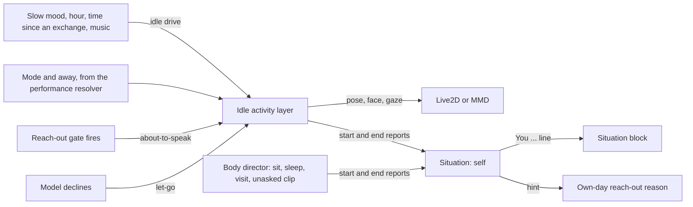

# Idle agency: self-directed behaviour on screen and in chat

Date: 2026-11-12
Status: accepted. The motion shapes were tuned on a rendered Live2D rig (see Validation); naturalness in motion and the pacing still need Luke's visual review, and MMD is tuned separately.

## Context

The product goal is a character who reads as independent: a VTuber who lives in the computer, not an avatar that waits for input. A review on 2026-11-12 found four gaps between that goal and the code.

1. **Idle had no intent.** Natural idle motion is fitted to desk recordings: wobble, posture shifts, blinks, breath, and fixations on the camera, the desk or the periphery. Nothing in it was a nameable act. No source file mentioned a stretch, a yawn or a doze. On MMD the curated clip library played only when the model asked for a clip.
2. **Slow state never reached the body.** The [layered character state](2026-11-03-layered-character-state.md) changes the resting face and the reach-out rate. She idled the same at 02:00 as at noon, and the Natural `energy` input was a static user setting.
3. **The model could not see her body.** The stage line of the situation block carried expressions only. An own-day reach-out used the fixed reason "something from your own day, small and plausible for who you are", so what she said about herself had no tie to what the user saw.
4. **Reach-outs had no body language.** An unprompted turn had no lead-in, because the model may still decline it. A decline, which the [cadence design](2026-10-29-unprompted-reach-out-cadence.md) treats as the normal outcome, left no trace on screen.

Live2D had one more gap. Sitting and sleeping need imported MMD clips, so on Live2D a user who left for an hour came back to a character who had looked at the camera with open eyes the whole time, at 0.7 times the amplitude.

## Decision

### One loop: act, know, tell

Three parts close the gaps together. The body does something on its own. The situation learns what it did. The prompt tells the model, and the model's own decisions show on the body.

### The idle activity layer (`motion-driver-natural`)

`NaturalIdleActivities` (`packages/motion-driver-natural/src/idle-activities.ts`) is a new Natural layer on its own stream, index 17.

- **It is inert without a drive.** `NaturalMotion.setIdleDrive(null)` is the default. Without a drive the layer draws nothing, adds nothing, and the controller composes exactly as before, so every seeded trace and gate from before this change replays unchanged. The T1 gates never set a drive. The T3 runner pins the new `idleActivities` setting off, because its gates score the base idle motion.
- **Activities are drawn by a hazard.** While she is free, `idleActivityRate` accumulates and an activity starts when the sum crosses an `Exp(1)` draw. The mean gap is 45 s in `idle` mode and 70 s in `watching` mode, plus a rest of 6 to 14 s after each activity. A simulated hour holds about 55 activities in `idle` mode and 37 in `watching` mode, and she is in one for about a tenth of the time.
- **Eight activities are drawn**, each with its own cooldown, and never the same one twice in a row: stretch, yawn, look-around, check-in (a look at the user, with a small smile unless her mood is low), peer (a lean toward the screen with reading saccades), zone-out, nod-off, and sway.
- **Sleep is a rule, not a draw.** While the user is away and the drive allows it, she falls asleep after 12 to 30 s: the lids close, the head drops, and breathing slows. She wakes when the user is back, with her eyes on the camera as the lids open. A sleep of at least 90 s is followed by a stretch or a yawn in 70 % of cases. A touch or a desktop wake rouses her at once; a busy screen does not.
- **Any behaviour can be played by name.** `NaturalIdleActivities.play(kind)` starts one behaviour at the next step in place of the running one, under the same conditions as a drawn activity. It exists for review and scripted QA: the Natural devtools page has one button per behaviour, sent to the stage like the gesture buttons. A played sleep does not need the user away and ends after 14 s.
- **Closed eyes do not depend on blinking.** The controller exposes `idleLidFactor`, the part of `blinkFactor` that a behaviour closes on purpose, outside the frame so recorded frame hashes are unchanged. The Live2D adapter applies it alone while the user's auto-blink is off, so she still closes her eyes to sleep.
- **Everything else outranks it.** An activity ends within 0.4 s and releases the gaze when she starts to talk, think or listen, when she is poked or petted, when an emotion or a cue gesture starts, and when she notices the cursor. Nothing starts while another layer owns the head or the eyes.
- **Eye closure rides on the blink factor.** The Live2D adapter keeps open lids above 0.2 for every multiplier and reaches fully closed only through the blink factor. Sleep and a nod-off therefore multiply the blink factor.
- **Posture calms through amplitude, not through the shift rate.** A hold drawn at a low shift rate would outlast the activity, so the shift-rate reduction is capped at 0.6 and the amplitude scale does the visible calming.

The drive (`NaturalIdleDrive`) has eight fields: `energy`, `valence` and `tension` (slow mood relative to her resting disposition), `sleepiness`, `solitude`, `music`, `allowSleep` and `rate`. `idleActivityWeights` turns it into odds. Tiredness, which is the larger of sleepiness and negative energy, favours yawns, zoning out and nodding off, and nodding off is possible only above 0.45. A lively mood favours looking around and watching the screen. Solitude raises check-ins. Tension makes her restless. Sway is drawn only while music plays. `idleEnergyOffset` also moves the Natural energy by `0.3 * energy - 0.15 * sleepiness`, so a drained evening idles visibly slower.

### The drive comes from the slower state (`stage-shared`, `stage-ui`)

`idleDriveOf` (`packages/stage-shared/src/character-state/idle.ts`) derives the first five fields from a character reading, the time, and the local hour.

- Mood counts as its distance from the resting disposition and is not damped. The resting face is damped after an interaction; how she idles should show her mood most when nobody is talking to her.
- `sleepinessAt` is 0 from 07:00 to 22:00, rises to 1 at 01:00, stays there until 05:00, and falls to 0 at 07:00. The evening ramp follows the late sign-off ritual.
- Solitude is `1 - 2^(-t / 30 min)` for the time `t` since the last interaction, and 0.5 before any.

The stage performance conductor sends the drive to the scene once a second, next to the face baseline, with `allowSleep: true` and `rate: 1`. A scene narrows it: the user's **Idle activities** setting switches it off, and an MMD model with a registered sleep clip turns `allowSleep` off so that its sleep stance and the Natural sleep never stack.

`resolveMusic` (`packages/stage-ui/src/components/scenes/idle-music.ts`) sets `music` when system audio stays above 0.1 for 8 s outside games, calls and chat apps, and while she is not speaking. It reads the signal the watching mode already uses, so no new sensor exists.

### She knows what she was doing (`stage-shared/situation`)

A new observation, `SelfObservation { activity, phase, label?, atMs }`, reports the start or the end of a self-directed activity. The reducer keeps `SituationState.self`: the activity in progress and the three newest finished ones.

- **It is never an event.** A self observation enters no event ring, so the reach-out gate cannot pick it as a topic. The rule against idle chatter in the [situational presence ADR](2026-10-19-situational-presence.md) holds: she does not speak because she yawned.
- **It renders as one line**, after the app lines and before the `New:` events, for example `You dozed off for about 40 min just now.` or `You are zoning out; before that you almost said something and let it go 2 min ago.` A finished activity is told for 10 minutes, and a sleep or a sit for 30 minutes with its length.
- **The block budget grew** from 6 lines and 500 characters to 7 lines and 600 characters, so the new line displaces nothing that fitted before.
- **Own-day reach-outs are anchored.** `collectReasons` appends `selfHint` to the own-day reason, for example `(you just yawned)`. Without a recent activity the reason text is unchanged.
- **A sleep or a sit goes on around short activities.** A yawn that starts while she sits does not end the sit; the line then reads `You are sitting down, for about 5 min now, and you yawned 2 min ago.`
- **A lost end report cannot stick.** An activity that cannot last, such as a yawn, is ignored once it has been "in progress" for more than 2 minutes. A scene also reports the end when its model unloads or when Natural stops driving it.

`useStageSelfStore` forwards scene reports to the leader over `situationSelfObservedEvent` on the speech bus, the same way touch observations travel. `about-to-speak` is not forwarded. `let-go` is forwarded once, as the finished activity `held-back`.

### The decision to speak shows on her body

- When an unprompted turn is sent, `Stage.vue` requests the `about-to-speak` cue: a small breath in, a lifted look at the user, and calmer posture, held for at most 10 s. A touch reaction turn gets no cue, because her body already reacted to the touch.
- When she speaks, the talking mode ends the hold.
- When the turn is declined, `Stage.vue` requests `let-go`: the breath goes out and the look drops aside, more so in a low mood. A decision that arrives after the hold ran out still shows as letting go within 30 s.

Both cues cost no model call. They turn the most common outcome of the gate, a silent decline, into something the user can see, and the next prompt can tell her that she held something back.

### The MMD body acts on its own too (`motion-driver-humanoid`, `stage-ui-mmd`)

- **Unasked clips.** Clip curation gained `idleMayUse` ("Idle may use"), off by default, next to `aiMayUse`. `decideIdleClip` (`packages/motion-driver-humanoid/src/idle-clips/`) is a pure scheduler with the same hazard design: a mean gap of 4 minutes of quiet time, at least 60 s between clips, and a repeat time by kind of 5 minutes for a gesture, 15 for an action and 45 for a dance. The scene sends the chosen clip to the director with the new `idle` source.
- **The `idle` source is the weakest request.** The director refuses it while anything performs, while she walks, and while she talks, listens or thinks. It arms no refractory and no gesture cooldown, so it never makes the model's own request wait. A request from any other source replaces it. It ends when the user touches or drags her, opens the chat, sends a message, or when she starts to talk. The director still never names a clip itself.
- **Visits.** A due wander now walks toward where the user is working in 60 % of cases, when the cursor is on her stage and far enough away, and stops 1.5 leg lengths short of it (`visit`). While the user is active (`watching` mode) a due wander is always a visit; without a place to visit it stays due until the user pauses. The cursor is the only cross-platform proxy for where the user works until the M4 window-rect sensor exists.
- **Lingering.** After a wander or a visit she stays for 45 to 150 s before she strolls home. The earlier 20 s return read as mechanical.
- **Body reports.** The scene reports sitting, sleeping, a wander, a visit, the walk home and an unasked clip as self observations, with the clip's label.

### Her own expressions on Live2D (`stage-shared/expression-performance`, `stage-ui-live2d`, `stage-ui`)

A Live2D rig cannot walk or play a clip, but most VTuber rigs ship switches for exactly the things a person does alone: a game controller, a snack, a pillow, a sleep bubble. She may now use them unasked, which is the Live2D counterpart of the unasked clips above.

- **Curation.** A catalog entry gained `idleUse`: `never` (the default, also when absent), `activity`, or `sleep`. The entry editor of the expression panel offers it as "On her own" when the snapshot sets `supportsIdleUse`, which only the Live2D store does. Nothing is used until the user allows it, because a switch's meaning is rig specific. A reversed switch, a hidden duplicate and a system entry never qualify. Combos have no `idleUse` yet.
- **Pastimes.** `decideIdleProp` (`idle-props.ts`) is a pure scheduler with the hazard design of the idle layer: a mean gap of 6 minutes of free time, a rest of 2 minutes after every pastime and after the stage opens, and a hold of 90 to 300 s. The same pastime is not picked twice in a row, nor within 15 minutes, while another is offered. She is free while the mode is `idle` or `watching`, the user is present and she is awake; a pastime ends the moment she is not, so she puts it away to talk and before she sleeps.
- **Sleep entries.** Entries marked `sleep` come on 5 s after she starts to fall asleep, when her eyes are nearly shut, and go off the moment she wakes. They follow the sleep report of the idle layer, so a sleep played from the devtools page shows them too.
- **A claim layer of her own.** The Live2D expression store holds her entries as claims at layer 0.5: above the user's switches at layer 0, so her pick wins a choose-one group for a while, and below the slot leases at layer 1, so an expression the model asks for still shows. `setIdleClaims` replaces the set and never claims an entry the user switched on. When the user changes her look by hand the store drops her claims; `useIdleProps` (`stage-ui`) sees the pastime gone and ends it. An entry she holds shows as on in the panel, and its switch takes it away.
- **The model is told.** A pastime is reported as the self activity `prop` with the entry's label: "You are busy with your "game", for about 3 min now." It is long-lived like a sleep, so a yawn during it does not end it, and it stays worth telling for 30 minutes. What she sleeps with is part of the sleep and gets no line of its own.
- **Conditions.** Both need the Natural driver and the Idle activities setting, like every other self-directed behaviour.

## Consequences

- **The idle motion users see changes.** With the setting on, a liveliness measurement of the running app differs from the gate profile, which pins the setting off. Naturalness of each activity is unproven until Luke reviews it on screen. The shapes were tuned on one rendered Live2D rig from still frames and parameter traces (see Validation).
- **MMD head motion is unverified.** The MMD body look-at stage runs after the Natural pose and may reduce the head offsets of an activity. The face, the lids and the reports do not depend on it.
- **Web hosts get activities and no sleep.** The drive is sent on every host. A host without desktop signals never reports the user as away, so she never sleeps there, and music is never detected.
- **Two stages report twice.** When two windows render a stage, the leader folds both sets of reports and the newer one wins.
- **Prompt size.** The block can be one line and 100 characters longer.
- **Reach-out cues depend on the active session.** A turn in another session shows no cue.
- **Stored curation gained a field.** `curationFor` reads a record saved before `idleMayUse` existed at its default, so no migration runs. The expression catalog document gained the optional `idleUse`, and an absent value means `never`.
- **A pastime can hide the user's switch for a few minutes.** Her pick outranks a manual switch of the same choose-one group until she puts it away. Toggling any switch ends it at once.
- **The MMD expression panel offers no "On her own" choice.** Its store does not set `supportsIdleUse`; MMD has unasked clips instead.

## Alternatives

- **Let the model choose idle activities.** A periodic model call that picks what she does costs tokens for something code can do, and its timing would follow latency. The same reasoning rejected model polling in the situational presence ADR. Code acts; the model is told afterwards.
- **Make activities gate topics.** Speaking about her own yawn is idle chatter with extra steps. Activities inform a turn that something else started.
- **Imported motion files for Live2D.** Motion groups differ per rig and most rigs ship none for idle. Procedural shapes on the Natural channels work on every rig and on MMD.
- **A separate sleep mode in the performance resolver.** `away` already exists as an overlay. Sleep is one behaviour of the idle layer that reads it.
- **Guessing pastimes from entry names.** A name such as "game" or "pillow" suggests a use, but a wrong guess would switch an outfit or a watermark on by itself. The user chooses per entry.
- **Holding a pastime through a slot lease.** A lease expires on a hold cap and belongs to a turn. A pastime lasts minutes and belongs to nobody's turn, so it is a claim layer of its own.
- **Arming the refractory for unasked clips.** The model would then be refused ("She can do that again in 60 s") for a dance it never asked for.

## Validation

- `motion-driver-natural`: `idle-activities.test.ts` covers the odds, the pace, the inert default, variety and rests over 30 simulated minutes, same-seed replay, interruption, sleep and waking, the cues, and pose range. One test checks that a controller without a drive, and one with a drive that starts nothing, match a plain controller frame for frame.
- `motion-driver-humanoid`: director tests cover visits, the visit share over 200 seeds, lingering, and every rule of the `idle` source. `idle-clips/index.test.ts` covers spacing, repeat times, quiet-time accounting, a resumed stage, and replay.
- `stage-shared`: `character-state/idle.test.ts` and `situation/self.test.ts` cover the drive, the reducer, the rendered line, the block position, and the own-day anchor.
- `stage-ui`, `stage-ui-live2d`: tests cover the self store, the music resolver, the conductor's driver gate, and the Live2D adapter closing the eyes and reporting across a driver change and disposal.
- Rendered Live2D pass, 2026-11-12, bear Pajama rig on macOS: every behaviour was played through `idlePlay` in the running app and read from frame sheets at its peaks and from post-physics parameter traces. The first shapes for stretch, yawn, check-in, peer, zone-out, sway, about-to-speak and let-go were too small to tell apart from the base idle motion, and were enlarged until each reads in a still frame. Look-around was kept; sleep and nod-off were deepened. Frame sheets prove that a pose reads, not that the motion between poses looks natural. That stays Luke's visual call, as does the pacing.
- Continuity, 2026-11-12: a per-step speed measurement through the full controller found that look-around and nod-off switched the posture amplitude in one step, which moved the head by up to 0.27 normalized units (about 8 degrees) in a single 120 Hz step at their start and end. Both now ease the calm in and out over 0.6 s. A test plays all eleven behaviours to their end and interrupted at 2 s, and fails when any head or body channel moves faster than 6 units per second; the fastest intended move, the head jerk of a nod-off, measures about 4.
- Pacing, 2026-11-12, three simulated hours per condition through the full controller at a neutral mood: 59 behaviours per hour while the user is inactive and 44 while they work, with a behaviour in progress 7 to 13 % of the time and a longest quiet stretch of 4 to 7 minutes. At 1 am while the user works the mix moves to yawns, nod-offs and zoning out (41 per hour). These numbers describe the scheduler; whether the pace feels right on screen is Luke's call.
- Her own expressions: `idle-props.test.ts` covers spacing, hold lengths, the rest, repeats, interruption, a withdrawn entry, a paused stage and replay. `use-idle-props.test.ts` covers the stage side: reports, being spoken to, a manual change, sleep entries and their delay, the off switch, and disposal. The Live2D store tests cover the claim layer against manual switches and slot leases. On the bear Pajama rig the game entry showed the controller in her hands, and with the user away from the machine she fell asleep on her own with the pillow and the sleep bubble on, which a played sleep cleared at its end. A full pastime cycle on the scheduler's own timing was not watched in the running app.
- MMD shares the shapes and has had no rendered pass; it is tuned separately.

## Follow-ups

- Visual review and tuning of every shape, the pacing, and the hold lengths.
- `idleUse` for combos, so one pastime can switch several entries, and a gaze toward what she holds.
- A pace that follows the drive for pastimes, as it does for activities.
- A liveliness gate profile with idle activities on, once the shapes are accepted.
- The M4 window-rect sensor as the target of a visit and of the peer activity, in place of the cursor and the fixed screen point.
- A beat estimate for sway. Today its period is drawn between 1.7 and 2.3 s and ignores the music.
- VRM joins through the M5 adapter, which consumes the same controller.
